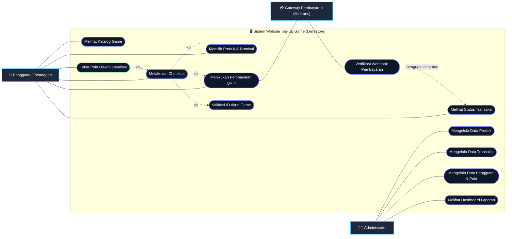
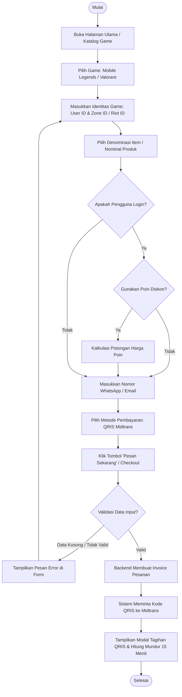
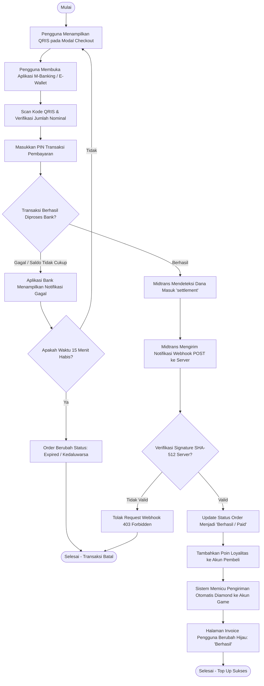
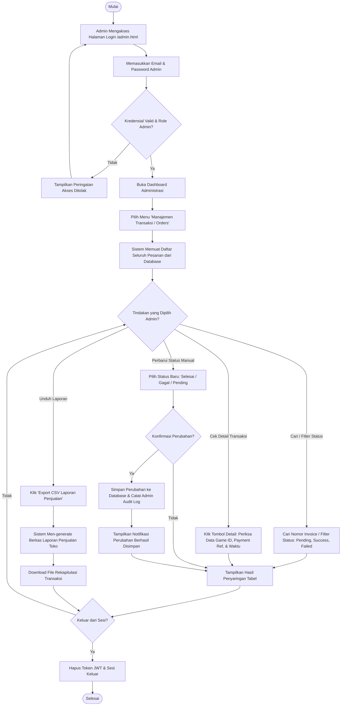
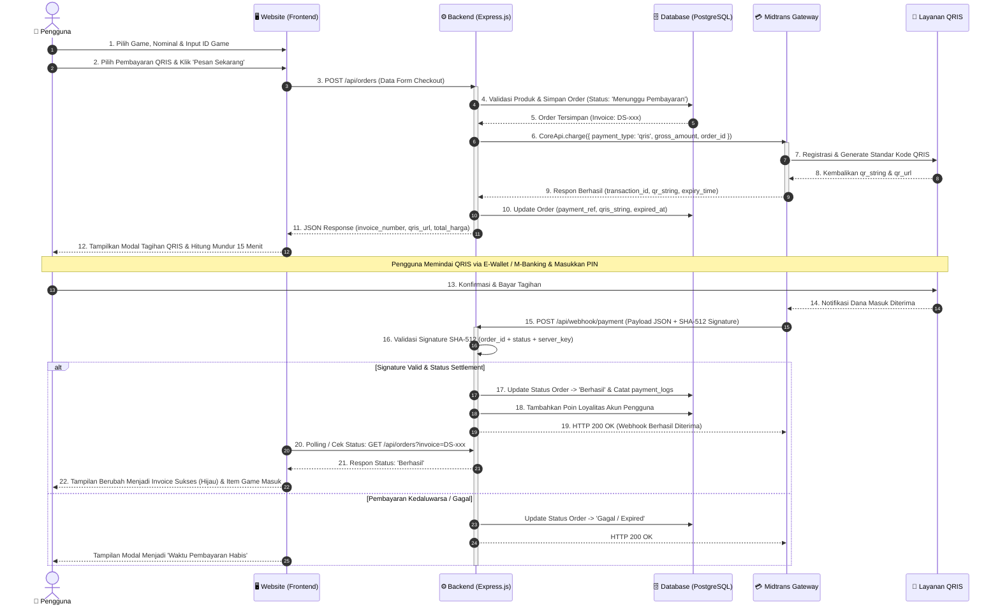

# BAGIAN A, B, & C: PERANCANGAN SISTEM (UML DIAGRAM)
**Sistem E-Commerce Top-Up Game Online — Dar'sstore**

---

## A. Use Case Diagram

### 1. Visualisasi Use Case Diagram
Berikut adalah representasi visual diagram use case untuk sistem website top-up game online Dar'sstore:

```
[ TEMPATKAN GAMBAR USE CASE DIAGRAM DI SINI ]
Contoh: 
```



---

### 2. Penjelasan Use Case Diagram
> **Penjelasan Resmi:**  
> Use Case Diagram menggambarkan interaksi antara pengguna dan admin dengan sistem website top-up game online. Pengguna dapat melihat katalog game, memilih produk, melakukan checkout, melakukan pembayaran QRIS, dan melihat status transaksi. Admin dapat mengelola data produk serta transaksi.

Secara lebih terperinci, hak akses dan peran masing-masing entitas didefinisikan sebagai berikut:

1. **Aktor Pengguna (Customer / Member):**
   - **Melihat Katalog Game:** Pengguna dapat menelusuri daftar game yang didukung oleh sistem (seperti *Mobile Legends: Bang Bang* dan *Valorant*).
   - **Memilih Produk:** Pengguna dapat menentukan denominasi/item (seperti nominal Diamond atau Valorant Points) sesuai kebutuhan.
   - **Melakukan Checkout:** Pengguna memasukkan User ID / Zone ID akun game, nomor WhatsApp atau email kontak, memilih metode bayar, serta meninjau rincian ringkasan pembelian (*Order Summary*).
   - **Melakukan Pembayaran QRIS:** Pengguna menerima tagihan pembayaran terstandarisasi Quick Response Code Indonesian Standard (QRIS) yang diproses melalui gateway Midtrans dan melakukan pemindaian melalui aplikasi perbankan digital/e-wallet.
   - **Melihat Status Transaksi:** Pengguna dapat mengecek invoice pembelian untuk mengetahui status pesanan secara *real-time* (*Menunggu Pembayaran*, *Diproses*, *Berhasil*, atau *Gagal*).
   - **Tukar Poin Diskon (Ekstensi):** Bagi pengguna yang terdaftar (*member*), sistem menyediakan opsi opsional untuk menukarkan poin loyalitas menjadi potongan harga langsung saat checkout.

2. **Aktor Administrator:**
   - **Mengelola Data Produk:** Admin memiliki hak penuh untuk menambah item baru, mengubah harga jual, mengunggah ikon, serta mengaktifkan/menonaktifkan ketersediaan produk.
   - **Mengelola Data Transaksi:** Admin dapat mengawasi arus pesanan masuk, memeriksa nomor invoice pelanggan, melakukan *retry* pengiriman manual jika terjadi gangguan provider, serta mengubah status transaksi.
   - **Mengelola Pengguna & Laporan:** Admin dapat melihat profil member, audit log aksi, serta statistik grafik penjualan toko.

3. **Aktor Pendukung (Midtrans Payment Gateway):**
   - Berfungsi sebagai pihak ketiga yang menerbitkan *string* QRIS, menetapkan batas waktu kedaluwarsa (15 menit), serta mengirimkan *callback HTTP webhook* terenkripsi untuk mengonfirmasi bahwa dana telah berhasil diterima (*settlement*).

---

## B. Activity Diagram

Activity Diagram memodelkan aliran kerja (*workflow*) logis dan sekuensial yang terjadi di dalam sistem dari satu aktivitas ke aktivitas lainnya.

---

### 1. Activity Diagram: Pengguna Melakukan Top-Up
Diagram ini menggambarkan alur kerja pengguna dari saat pertama kali membuka website hingga berhasil membuat pesanan top-up game.



#### Deskripsi Alur Aktivitas 1:
1. Pengguna membuka antarmuka website Dar'sstore dan memilih game yang ingin diisi ulang.
2. Pengguna menginput nomor identitas akun game (*User ID* dan *Zone ID* untuk MLBB, atau *Riot ID* untuk Valorant).
3. Pengguna memilih denominasi nominal produk (misal: 12 Diamonds).
4. Jika pengguna berstatus *member*, terdapat pilihan opsi penukaran poin loyalitas untuk memperoleh diskon.
5. Pengguna memasukkan nomor WhatsApp / email kontak penerima notifikasi, kemudian memilih opsi pembayaran QRIS.
6. Sistem memvalidasi kelengkapan form. Jika valid, sistem memproses pesanan ke backend dan menampilkan modal tagihan QRIS ke layar pengguna.

---

### 2. Activity Diagram: Proses Pembayaran QRIS
Diagram ini memodelkan proses pembayaran interaktif antara Pengguna, E-Wallet/M-Banking, Midtrans Payment Gateway, dan Server Backend Dar'sstore.



#### Deskripsi Alur Aktivitas 2:
1. Setelah kode QRIS ditampilkan pada modal checkout, pengguna membuka aplikasi M-Banking atau e-wallet (BCA Mobile, GoPay, OVO, Dana, Livin', dll.).
2. Pengguna memindai kode QRIS dan mengonfirmasi pembayaran dengan memasukkan PIN keamanan.
3. Midtrans menerima konfirmasi dana dari jaringan interkoneksi perbankan (status `settlement`).
4. Midtrans secara asinkron mengirimkan HTTP POST *webhook* ke `/api/webhook/payment` milik Dar'sstore.
5. Backend Dar'sstore memverifikasi integritas *signature key* dengan rumus SHA-512.
6. Jika *signature* cocok, status pesanan di database diperbarui dari `Menunggu Pembayaran` menjadi `Berhasil`, poin pengguna ditambahkan, dan proses injeksi item game diselesaikan.

---

### 3. Activity Diagram: Admin Mengelola Transaksi
Diagram ini memodelkan hak operasional administrator dalam mengawasi, memperbarui, dan menindaklanjuti seluruh transaksi penjualan.



#### Deskripsi Alur Aktivitas 3:
1. Administrator masuk melalui gerbang `/admin.html` dengan memasukkan kredensial otentikasi.
2. Setelah divalidasi, admin diarahkan ke panel navigasi manajemen pesanan.
3. Admin dapat mencari transaksi berdasarkan nomor invoice (misal: `DS...`), menyaring status transaksi, atau meninjau detail log webhook dari gateway pembayaran.
4. Apabila terjadi kendala teknis (seperti jaringan provider *down*), admin dapat mengubah status secara manual atau menjalankan proses *retry*. Setiap aksi administratif akan dicatat ke dalam tabel `admin_logs`.
5. Admin dapat mengunduh seluruh data transaksi dalam format file CSV untuk keperluan pembukuan keuangan.

---

## C. Sequence Diagram

Sequence Diagram memodelkan pertukaran pesan antar objek/komponen sistem secara kronologis berdasarkan waktu.

### Alur Proses Utama:
$$\text{Pengguna} \longrightarrow \text{Website (Frontend)} \longrightarrow \text{Backend API} \longrightarrow \text{Midtrans Gateway} \longrightarrow \text{QRIS} \longrightarrow \text{Status Pembayaran} \longrightarrow \text{Sistem}$$



---

### Penjelasan Rinci Tahapan Sequence Diagram:
1. **Pengguna $\rightarrow$ Website:** Pengguna memilih game, nominal item, memasukkan ID akun game, serta memilih opsi metode pembayaran QRIS.
2. **Website $\rightarrow$ Backend:** Frontend mengirimkan *payload* pesanan melalui *endpoint* `POST /api/orders`.
3. **Backend $\rightarrow$ Database:** Backend memvalidasi ketersediaan produk, mengkalkulasi diskon (bila ada), dan mencatat baris transaksi baru dengan status `Menunggu Pembayaran`.
4. **Backend $\rightarrow$ Midtrans:** Backend memanggil Midtrans Core API `coreApi.charge()` dengan spesifikasi parameter `payment_type: 'qris'`.
5. **Midtrans $\rightarrow$ QRIS $\rightarrow$ Backend:** Midtrans meregistrasikan transaksi ke jaringan QRIS nasional dan mengembalikan data `qr_string`, URL gambar QR, serta batas waktu 15 menit.
6. **Backend $\rightarrow$ Website $\rightarrow$ Pengguna:** Website menampilkan *pop-up modal* berisikan kode QRIS yang siap dipindai oleh pelanggan.
7. **Pengguna $\rightarrow$ QRIS:** Pengguna menyelesaikan pembayaran melalui aplikasi e-wallet (GoPay, OVO, Dana) atau mobile banking.
8. **Midtrans $\rightarrow$ Backend (Webhook):** Midtrans mengirimkan notifikasi *callback* HTTP POST ke backend Dar'sstore.
9. **Backend Verifikasi & Update:** Backend memverifikasi tanda tangan kriptografi SHA-512 untuk mencegah manipulasi data, lalu mengubah status transaksi di database menjadi `Berhasil`.
10. **Website $\rightarrow$ Pengguna:** Halaman antarmuka mendeteksi perubahan status transaksi secara otomatis dan menampilkan bukti pelunasan digital berwarna hijau beserta konfirmasi bahwa pesanan telah berhasil dikirim ke akun game.
