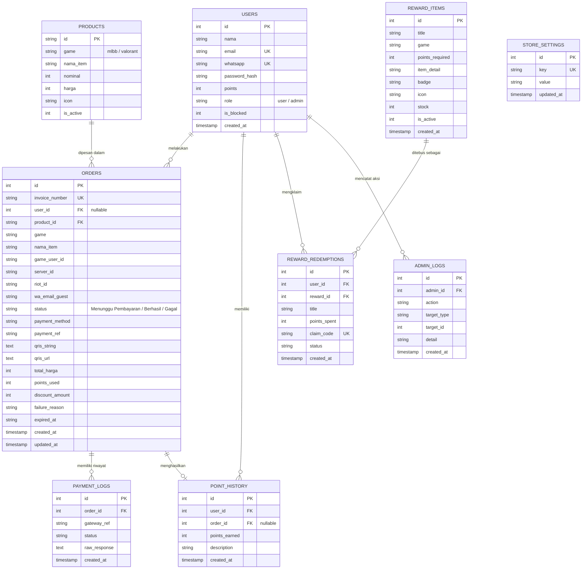

# BAGIAN D & E: PERANCANGAN DATABASE DAN ANTARMUKA
**Sistem E-Commerce Top-Up Game Online — Dar'sstore**

---

## D. Perancangan Database

Perancangan basis data (*database design*) sistem Dar'sstore menggunakan sistem manajemen basis data relasional **PostgreSQL** (di-hosting pada platform cloud Supabase). Desain skema dirancang secara optimal untuk mendukung integritas transaksi keuangan (*ACID compliant*), pencatatan pembayaran QRIS Midtrans, serta manajemen katalog produk digital.

---

### 1. Entity Relationship Diagram (ERD)

Diagram di bawah menggambarkan relasi antar entitas utama sistem: Pengguna (`users`), Produk (`products`), Transaksi/Pesanan (`orders`), Log Pembayaran Gateway (`payment_logs`), Riwayat Poin (`point_history`), dan Hadiah Loyalitas (`reward_items` & `reward_redemptions`).



---

### 2. Tabel-Tabel PostgreSQL

Berikut adalah spesifikasi struktur dan kamus data (*data dictionary*) tabel-tabel utama di dalam PostgreSQL:

#### a. Tabel `users` (Pengguna & Administrator)
Menyimpan data pengguna terdaftar (*member*) dan administrator sistem.
| Nama Kolom | Tipe Data | Constraint | Keterangan |
| :--- | :--- | :--- | :--- |
| `id` | `SERIAL` | `PRIMARY KEY` | Identifier unik pengguna |
| `nama` | `VARCHAR(100)` | `NOT NULL` | Nama lengkap pengguna |
| `email` | `VARCHAR(100)` | `UNIQUE` | Alamat email aktif untuk autentikasi |
| `whatsapp` | `VARCHAR(20)` | `UNIQUE` | Nomor WhatsApp pengguna |
| `password_hash` | `VARCHAR(255)` | `NOT NULL` | Kata sandi terenkripsi (Bcrypt) |
| `points` | `INTEGER` | `DEFAULT 0` | Saldo poin loyalitas |
| `role` | `VARCHAR(20)` | `DEFAULT 'user'` | Peran pengguna (`user` atau `admin`) |
| `is_blocked` | `SMALLINT` | `DEFAULT 0` | Status blokir akun (0 = Aktif, 1 = Diblokir) |
| `created_at` | `TIMESTAMP` | `DEFAULT CURRENT_TIMESTAMP` | Waktu registrasi |

#### b. Tabel `products` (Katalog Game & Produk)
Menyimpan daftar produk game, denominasi diamond / points, harga beli, dan status aktif.
| Nama Kolom | Tipe Data | Constraint | Keterangan |
| :--- | :--- | :--- | :--- |
| `id` | `VARCHAR(50)` | `PRIMARY KEY` | Kode SKU produk (contoh: `ml_dm_1`, `vp_id_1`) |
| `game` | `VARCHAR(30)` | `NOT NULL` | Kategori game (`mlbb` / `valorant`) |
| `nama_item` | `VARCHAR(150)` | `NOT NULL` | Nama varian paket (contoh: `12 (11+1) Diamonds`) |
| `nominal` | `INTEGER` | `NOT NULL` | Jumlah diamond / voucher yang didapatkan |
| `harga` | `INTEGER` | `NOT NULL` | Harga jual dalam Rupiah (IDR) |
| `icon` | `VARCHAR(255)` | `NULL` | Path URL ikon diamond atau VP |
| `is_active` | `SMALLINT` | `DEFAULT 1` | Ketersediaan produk (1 = Tersedia, 0 = Nonaktif) |

#### c. Tabel `orders` (Transaksi / Pemesanan)
Menyimpan semua transaksi pesanan yang dilakukan pelanggan (tamu maupun member terdaftar).
| Nama Kolom | Tipe Data | Constraint | Keterangan |
| :--- | :--- | :--- | :--- |
| `id` | `SERIAL` | `PRIMARY KEY` | ID internal urutan pesanan |
| `invoice_number` | `VARCHAR(50)` | `UNIQUE, NOT NULL` | Nomor invoice resmi (contoh: `DS177439201`) |
| `user_id` | `INTEGER` | `FOREIGN KEY (users.id), NULL` | ID member (NULL jika pelanggan tamu/guest) |
| `product_id` | `VARCHAR(50)` | `FOREIGN KEY (products.id)` | Referensi produk yang dibeli |
| `game` | `VARCHAR(30)` | `NOT NULL` | Game yang dipesan (`mlbb` / `valorant`) |
| `nama_item` | `VARCHAR(150)` | `NOT NULL` | Nama item produk yang dipesan |
| `game_user_id` | `VARCHAR(50)` | `NULL` | User ID akun Mobile Legends pelanggan |
| `server_id` | `VARCHAR(30)` | `NULL` | Zone ID akun Mobile Legends pelanggan |
| `riot_id` | `VARCHAR(100)` | `NULL` | Riot ID (Username#Tagline) Valorant |
| `wa_email_guest` | `VARCHAR(100)` | `NOT NULL` | Kontak WhatsApp / email pemesan |
| `status` | `VARCHAR(50)` | `DEFAULT 'Menunggu Pembayaran'` | Status transaksi (`Menunggu Pembayaran`, `Berhasil`, `Gagal`, `Expired`) |
| `payment_method`| `VARCHAR(50)` | `NOT NULL` | Metode bayar (contoh: `QRIS Midtrans`) |
| `payment_ref` | `VARCHAR(100)` | `NULL` | ID referensi transaksi gateway Midtrans |
| `qris_string` | `TEXT` | `NULL` | *Payload raw string* standar QRIS |
| `qris_url` | `TEXT` | `NULL` | URL file gambar QR Code siap pindai |
| `total_harga` | `INTEGER` | `NOT NULL` | Total nominal bayar akhir (IDR) |
| `points_used` | `INTEGER` | `DEFAULT 0` | Jumlah poin diskon yang digunakan |
| `discount_amount`| `INTEGER` | `DEFAULT 0` | Potongan harga yang diperoleh |
| `failure_reason`| `TEXT` | `NULL` | Catatan kegagalan jika transaksi dibatalkan |
| `expired_at` | `VARCHAR(50)` | `NULL` | Batas kedaluwarsa waktu pembayaran (15 menit) |
| `created_at` | `TIMESTAMP` | `DEFAULT CURRENT_TIMESTAMP` | Waktu pesanan dibuat |
| `updated_at` | `TIMESTAMP` | `DEFAULT CURRENT_TIMESTAMP` | Waktu pembaruan status |

#### d. Tabel `payment_logs` (Pencatatan Pembayaran Gateway)
Mencatat *audit trail* notifikasi *webhook* dari Midtrans secara mentah (*raw*) untuk audit keamanan dan mencegah *fraud*.
| Nama Kolom | Tipe Data | Constraint | Keterangan |
| :--- | :--- | :--- | :--- |
| `id` | `SERIAL` | `PRIMARY KEY` | Identifier log pembayaran |
| `order_id` | `INTEGER` | `FOREIGN KEY (orders.id)` | Hubungan relasi ke pesanan |
| `gateway_ref` | `VARCHAR(100)` | `NULL` | ID transaksi Midtrans (`transaction_id`) |
| `status` | `VARCHAR(50)` | `NOT NULL` | Status callback (`settlement`, `pending`, `expire`) |
| `raw_response` | `TEXT` | `NULL` | Payload JSON mentah yang diterima dari Midtrans |
| `created_at` | `TIMESTAMP` | `DEFAULT CURRENT_TIMESTAMP` | Waktu log dicatat |

#### e. Tabel `point_history` (Poin Loyalitas Pengguna)
Mencatat perolehan poin setiap kali pengguna sukses bertransaksi.
| Nama Kolom | Tipe Data | Constraint | Keterangan |
| :--- | :--- | :--- | :--- |
| `id` | `SERIAL` | `PRIMARY KEY` | Identifier transaksi poin |
| `user_id` | `INTEGER` | `FOREIGN KEY (users.id)` | Pengguna pemilik poin |
| `order_id` | `INTEGER` | `FOREIGN KEY (orders.id), NULL` | Hubungan transaksi pembelian |
| `points_earned` | `INTEGER` | `NOT NULL` | Jumlah poin yang diperoleh |
| `description` | `VARCHAR(255)` | `NULL` | Keterangan sumber penambahan poin |
| `created_at` | `TIMESTAMP` | `DEFAULT CURRENT_TIMESTAMP` | Waktu penambahan poin |

---

### 3. Relasi Antar Tabel
1. **Relasi `users` ke `orders` (1 : N / One-to-Many):**
   Satu pengguna terdaftar dapat melakukan banyak transaksi pemesanan (`orders`). Nilai `user_id` bersifat opsional (*nullable*) untuk mendukung pembelian langsung oleh tamu (*guest checkout*).
2. **Relasi `products` ke `orders` (1 : N / One-to-Many):**
   Satu item produk pada katalog dapat dipesan berkali-kali dalam berbagai nomor invoice transaksi.
3. **Relasi `orders` ke `payment_logs` (1 : N / One-to-Many):**
   Satu transaksi dapat memiliki beberapa rekaman log pembayaran (misal: saat dibuat berstatus `pending`, kemudian menerima webhook `settlement`).
4. **Relasi `users` ke `point_history` (1 : N / One-to-Many):**
   Satu akun pengguna memiliki banyak riwayat mutasi penambahan/pengurangan poin.
5. **Relasi `users` ke `admin_logs` (1 : N / One-to-Many):**
   Satu administrator dapat melakukan banyak tindakan manajemen pada pesanan dan katalog produk.

---

### 4. Skrip DDL PostgreSQL (Schema Initialization)

```sql
-- 1. Tabel Users
CREATE TABLE IF NOT EXISTS users (
    id SERIAL PRIMARY KEY,
    nama VARCHAR(100) NOT NULL,
    email VARCHAR(100) UNIQUE,
    whatsapp VARCHAR(20) UNIQUE,
    password_hash VARCHAR(255) NOT NULL,
    points INTEGER DEFAULT 0,
    role VARCHAR(20) DEFAULT 'user',
    is_blocked SMALLINT DEFAULT 0,
    created_at TIMESTAMP DEFAULT CURRENT_TIMESTAMP
);

-- 2. Tabel Products
CREATE TABLE IF NOT EXISTS products (
    id VARCHAR(50) PRIMARY KEY,
    game VARCHAR(30) NOT NULL,
    nama_item VARCHAR(150) NOT NULL,
    nominal INTEGER NOT NULL,
    harga INTEGER NOT NULL,
    icon VARCHAR(255),
    is_active SMALLINT DEFAULT 1
);

-- 3. Tabel Orders (Transactions)
CREATE TABLE IF NOT EXISTS orders (
    id SERIAL PRIMARY KEY,
    invoice_number VARCHAR(50) UNIQUE NOT NULL,
    user_id INTEGER REFERENCES users(id) ON DELETE SET NULL,
    product_id VARCHAR(50) REFERENCES products(id),
    game VARCHAR(30) NOT NULL,
    nama_item VARCHAR(150) NOT NULL,
    game_user_id VARCHAR(50),
    server_id VARCHAR(30),
    riot_id VARCHAR(100),
    wa_email_guest VARCHAR(100) NOT NULL,
    status VARCHAR(50) DEFAULT 'Menunggu Pembayaran',
    payment_method VARCHAR(50) NOT NULL,
    payment_ref VARCHAR(100),
    qris_string TEXT,
    qris_url TEXT,
    total_harga INTEGER NOT NULL,
    points_used INTEGER DEFAULT 0,
    discount_amount INTEGER DEFAULT 0,
    failure_reason TEXT,
    expired_at VARCHAR(50),
    created_at TIMESTAMP DEFAULT CURRENT_TIMESTAMP,
    updated_at TIMESTAMP DEFAULT CURRENT_TIMESTAMP
);

-- 4. Tabel Payment Logs
CREATE TABLE IF NOT EXISTS payment_logs (
    id SERIAL PRIMARY KEY,
    order_id INTEGER REFERENCES orders(id) ON DELETE CASCADE,
    gateway_ref VARCHAR(100),
    status VARCHAR(50) NOT NULL,
    raw_response TEXT,
    created_at TIMESTAMP DEFAULT CURRENT_TIMESTAMP
);

-- 5. Tabel Point History
CREATE TABLE IF NOT EXISTS point_history (
    id SERIAL PRIMARY KEY,
    user_id INTEGER REFERENCES users(id) ON DELETE CASCADE,
    order_id INTEGER REFERENCES orders(id) ON DELETE SET NULL,
    points_earned INTEGER NOT NULL,
    description VARCHAR(255),
    created_at TIMESTAMP DEFAULT CURRENT_TIMESTAMP
);

-- 6. Tabel Store Settings
CREATE TABLE IF NOT EXISTS store_settings (
    id SERIAL PRIMARY KEY,
    key VARCHAR(100) UNIQUE NOT NULL,
    value TEXT NOT NULL,
    updated_at TIMESTAMP DEFAULT CURRENT_TIMESTAMP
);
```

---

## E. Perancangan Antarmuka

Perancangan antarmuka pengguna (*User Interface Design*) untuk Dar'sstore telah dimodelkan menggunakan perangkat lunak **Figma** dengan konsep **Dark Modern Gaming & Glassmorphism**. Desain menekankan kemudahan transaksi cepat (*instant 3-step checkout*) dan responsif pada perangkat *mobile* maupun *desktop*.

---

### 1. Halaman Beranda (Home)
- **Tujuan:** Menyambut pengunjung, menampilkan identitas brand toko, dan menyediakan akses cepat menuju game terpopuler.
- **Komponen Wireframe / Figma:**
  - **Header Navigasi:** Logo resmi Dar'sstore, pencarian game instan (*Search Bar*), tombol Lacak Pesanan (`/cek-transaksi`), tombol Leaderboard, dan tombol Masuk/Daftar.
  - **Hero Banner:** Banner animasi promo spesial dan event skin Mobile Legends / Valorant Points.
  - **Grid Kategori Game:** Kartu visual game unggulan (*Mobile Legends: Bang Bang*, *Valorant*) dengan efek hover glow neon.
  - **Fitur Nilai Tambah (*Value Proposition*):** Ikon layanan instan 24/7, jaminan transaksi aman, dan sistem QRIS instan.
  - **Footer:** Tautan FAQ, kontak WhatsApp CS resmi, dan hak cipta.

```
+-----------------------------------------------------------------------+
|  [LOGO] Dar'sstore     [Search Game...]      [Lacak]  [Login/Daftar]  |
+-----------------------------------------------------------------------+
|  +-----------------------------------------------------------------+  |
|  | [HERO SLIDER BANNER] Event Promo Diamond & Skin Termurah 24 Jam |  |
|  +-----------------------------------------------------------------+  |
|                                                                       |
|  POPULER SEKARANG:                                                    |
|  +-----------------------+   +-----------------------+                |
|  | [CARD MLBB]           |   | [CARD VALORANT]       |                |
|  | Mobile Legends        |   | Riot Games            |                |
|  | Top Up Instan         |   | Points Instant        |                |
|  +-----------------------+   +-----------------------+                |
+-----------------------------------------------------------------------+
```

---

### 2. Katalog Game
- **Tujuan:** Menampilkan daftar katalog seluruh judul game yang didukung untuk memudahkan pengguna menemukan game favoritnya.
- **Komponen Wireframe / Figma:**
  - Filter kategori genre (MOBA, FPS, RPG).
  - Kartu thumbnail beresolusi tinggi dengan indikator status server game (*Active / Maintenance*).
  - Indikator ketersediaan promo dan cashback poin loyalitas.

---

### 3. Detail Produk (Pilihan Nominal)
- **Tujuan:** Memberikan pilihan denominasi paket top up (Diamonds atau Valorant Points) yang transparan dan lengkap.
- **Komponen Wireframe / Figma:**
  - **Section Pilihan Nominal:** Grid kartu denominasi dari pecahan terkecil (5 Diamonds) hingga bundle terbesar (28.900 Diamonds).
  - **Komponen Kartu Produk:** Ikon diamond, nama varian (contoh: `86 (78+8) Diamonds`), dan label harga tertera jelas dalam Rupiah.
  - **State Interaktif:** Efek seleksi aktif (border gradien biru menyala dan centang hijau) ketika produk diklik oleh pengguna.
  - **Selector Kuantitas:** Counter penambah kuantitas `[-] [1] [+]` untuk pembelian lebih dari satu paket.

---

### 4. Checkout (Form Pembeli & Ringkasan Pesanan)
- **Tujuan:** Memvalidasi akun tujuan dan kontak penerima sebelum pembayaran diproses.
- **Komponen Wireframe / Figma:**
  - **Step 1 - Data Akun:** Field input *User ID* dan *Zone ID* (untuk MLBB) atau *Riot ID Tagline* (untuk Valorant), dilengkapi tombol panduan letak User ID game.
  - **Step 2 - Kontak Konfirmasi:** Field nomor WhatsApp dan Email untuk pengiriman struk bukti transaksi.
  - **Step 3 - Pilihan Pembayaran:** Opsi metode pembayaran *QRIS Midtrans* berlogo resmi Bank Indonesia & ASPI.
  - **Sticky Order Summary:** Panel ringkasan belanja di sebelah kanan yang menghitung Subtotal, Biaya Layanan, Potongan Diskon Poin, dan Total Bayar.
  - **Tombol CTA:** Tombol interaktif "Pesan Sekarang!" yang memicu pembuatan invoice.

```
+-----------------------------------+   +-------------------------------+
| 1. MASUKKAN DATA AKUN             |   | RINGKASAN PESANAN (STICKY)    |
| [User ID: 12345678] [Zone: 2024]  |   | ----------------------------- |
|                                   |   | Game    : Mobile Legends      |
| 2. PILIH METODE BAYAR             |   | Item    : 86 Diamonds         |
| [X] QRIS (Midtrans Sandbox)       |   | Harga   : Rp 27.232           |
|                                   |   | Biaya   : Rp 0                |
| 3. KONTAK PEMBELI                 |   | Total   : Rp 27.232           |
| [WhatsApp: 08123456789]           |   |                               |
|                                   |   | [ PESAN SEKARANG! ]           |
+-----------------------------------+   +-------------------------------+
```

---

### 5. Pembayaran QRIS (Modal Checkout)
- **Tujuan:** Menampilkan kode QRIS dinamis dari Midtrans agar dapat segera dipindai pelanggan.
- **Komponen Wireframe / Figma:**
  - **Pop-Up Modal Dialog:** Tampil otomatis dengan efek latar belakang *backdrop blur*.
  - **Header Tagihan:** Nomor invoice pesanan unik (contoh: `DS177439201`) dan total nominal tagihan hingga digit satuan.
  - **Gambar QR Code:** Kode QRIS resmi dengan logo National Merchant.
  - **Timer Countdown:** Penghitung mundur waktu kedaluwarsa 15:00 menit secara *real-time*.
  - **Panduan Pembayaran:** Petunjuk langkah scan menggunakan BCA Mobile, GoPay, OVO, ShopeePay, Dana, dan Livin'.

---

### 6. Status Transaksi (Halaman Invoice & Tracking)
- **Tujuan:** Menampilkan bukti pembayaran digital serta status eksekusi pesanan.
- **Komponen Wireframe / Figma:**
  - **Pencarian Invoice:** Input field nomor invoice bagi pengguna umum di `/cek-transaksi`.
  - **Badge Status Real-Time:** 
    - Oranye: *Menunggu Pembayaran*
    - Hijau: *Pembayaran Berhasil / Selesai*
    - Merah: *Transaksi Gagal / Kedaluwarsa*
  - **Rincian Invoice:** Rincian ID transaksi gateway, ID game tujuan, tanggal pembelian, dan rincian harga.
  - **Tombol Aksi:** Tombol "Cetak / Unduh Struk" dan tombol "Hubungi CS WhatsApp" jika membutuhkan bantuan.

---

### 7. Dashboard Admin
- **Tujuan:** Pusat komando pengelola toko untuk memantau performa bisnis dan mengatur operasional.
- **Komponen Wireframe / Figma:**
  - **Sidebar Navigasi:** Menu Ringkasan (Dashboard), Manajemen Pesanan, Katalog Produk, Data Pengguna, dan Pengaturan Toko.
  - **Kartu KPI Metrik:** Total Omset Penjualan (Rupiah), Jumlah Pesanan Berhasil, Transaksi Pending, dan Jumlah Pelanggan Baru.
  - **Tabel Transaksi Real-Time:** Daftar transaksi pesanan dengan fitur filter status, kolom aksi *detail modal*, tombol *retry*, dan tombol ubah status pesanan.
  - **Tabel Kelola Produk:** Form penambahan denominasi baru, tombol edit harga, dan *switch toggle* status produk aktif/nonaktif.
