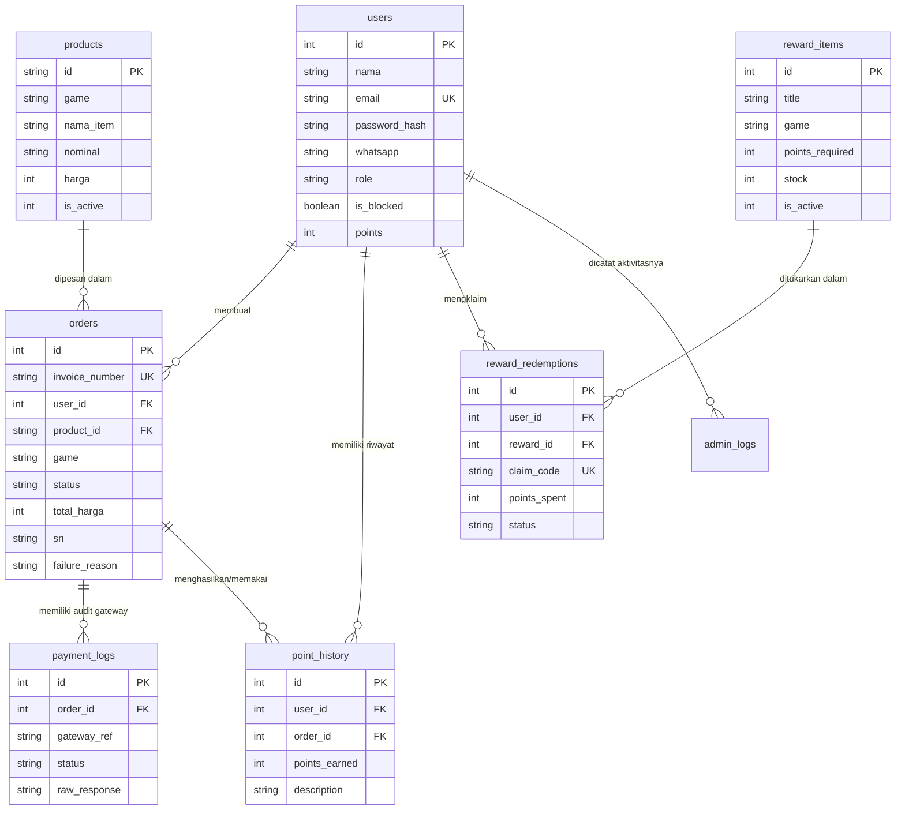

# DOKUMEN BUKTI AUDIT KODE: BAHAN REVISI BAB 4 TUGAS AKHIR
**Nama Proyek:** Dar'sstore (Platform E-Commerce Top-Up Game & Voucher Digital)  
**Lingkup Tugas Akhir:** D3 Teknologi Informasi  
**Fokus Audit:** Verifikasi Implementasi Nyata, Migrasi Midtrans Production, dan Pemenuhan Otomatis Digiflazz  
**Status Audit:** Selesai (Berdasarkan Inspeksi Statis & Eksekusi Lokal Kode Sumber)  

---

## A. Ringkasan Proyek

### 1. Struktur Direktori Proyek (Maksimal 3 Tingkat)
```text
darstore/
├── backend/
│   ├── prisma/
│   │   ├── schema.prisma
│   │   └── seed.js
│   ├── src/
│   │   ├── config/ (db.js, prisma.js, supabase.js)
│   │   ├── controllers/ (admin, auth, leaderboard, order, reward, webhook)
│   │   ├── data/ (dummyLeaderboard.js)
│   │   ├── jobs/ (processOrderQueue.js)
│   │   ├── middlewares/ (auth, isAdmin, rateLimit)
│   │   ├── routes/ (admin, auth, leaderboard, order, payment, product, reward, webhook)
│   │   ├── services/ (emailService, leaderboardSeeder, paymentGateway, topupProvider)
│   │   └── server.js
│   ├── .env (gitignored)
│   ├── .env.example
│   ├── database.sqlite (fallback local dev)
│   └── package.json
├── frontend/
│   ├── public/
│   │   └── assets/ (banners, games, icons, logo, news, payments, social)
│   ├── src/
│   │   ├── api/ (auth, client, leaderboard, orders, products, rewards)
│   │   ├── components/ (modals, paymentAccordion, rewardsModal)
│   │   ├── data/ (faqs, games, index, ml-nominals, payments, valo-nominals)
│   │   ├── utils/ (countdown, cyberPopup, format, invoiceNumber, state, token)
│   │   ├── views/ (homepage, invoiceView, leaderboardView, mlView, valoView)
│   │   ├── admin.css, admin.js, main.js, style.css
│   ├── admin.html
│   ├── index.html
│   ├── package.json
│   ├── vercel.json
│   └── vite.config.js
├── docs/ (berkas dokumentasi & audit)
├── .env (root environment - gitignored)
├── package.json (root workspace)
└── vercel.json (monorepo routing)
```

### 2. Bahasa, Runtime, Framework, dan Dependensi
* **Runtime:** Node.js (CommonJS untuk backend, ES Modules untuk frontend).
* **Framework Backend:** Express.js `^5.2.1` (`backend/package.json:25`).
* **Framework/Bundler Frontend:** Vite `^6.2.0` (`frontend/package.json:13`), Vanilla HTML5/CSS3/JavaScript tanpa framework frontend berat (React/Vue) untuk memaksimalkan performa dan kontrol DOM.
* **Database Driver & ORM:**
  * Prisma Client `^6.19.3` (`backend/package.json:20`).
  * PostgreSQL Client `pg` `^8.23.0` (`backend/package.json:29`) untuk koneksi pooler Supabase Cloud.
  * SQLite3 `^6.0.1` (`backend/package.json:32`) untuk fallback penyimpanan lokal jika cloud database offline.
  * Supabase Client `@supabase/supabase-js` `^2.116.0` (`backend/package.json:21`).
* **Payment Gateway & Vendor:**
  * `midtrans-client` `^1.4.3` (`backend/package.json:27`).
* **Email Provider:**
  * `nodemailer` `^10.1.0` (`backend/package.json:28`) untuk SMTP Gmail.
  * `resend` `^6.32.1` (`backend/package.json:31`) untuk API Resend transactional email.
* **Keamanan & Utilitas:**
  * `bcryptjs` `^3.0.3` (`backend/package.json:22`) untuk hashing password (10 salt rounds).
  * `jsonwebtoken` `^9.0.3` (`backend/package.json:26`) untuk penerbitan token autentikasi (JWT).
  * `cors` `^2.8.6` (`backend/package.json:23`) untuk pengamanan Cross-Origin Resource Sharing.
  * `dotenv` `^17.4.2` (`backend/package.json:24`) untuk pemuatan variabel lingkungan.

### 3. Perintah Menjalankan Proyek (`scripts`), Port, dan Arsitektur
* **Port Server:** Port 3000 (`backend/src/server.js:18`, dikendalikan via `process.env.PORT || 3000`).
* **Port Frontend Dev:** Port 5173 (default Vite server).
* **Perintah Terminal:**
  * `npm run dev`: Menjalankan server pengembangan frontend Vite (`package.json:6`).
  * `npm run server`: Menjalankan backend server Express.js (`package.json:7` -> `node src/server.js`).
  * `npm run dev:backend`: Menjalankan backend dengan file watcher (`backend/package.json:8` -> `node --watch src/server.js`).
  * `npm run build`: Melakukan bundling frontend ke direktori `dist/` (`frontend/package.json:8`).
* **Struktur Monorepo Vercel (`vercel.json:1-26`):**
  * Routing `/api/(.*)` diarahkan ke layanan `backend` (`entrypoint: src/server.js`).
  * Routing `/(.*)` diarahkan ke layanan statis `frontend`.

### 4. Daftar Nama Variabel Environment (`.env`) dan Fungsinya
| Nama Variabel | Fungsi dalam Sistem | Status Nilai |
| :--- | :--- | :--- |
| `PORT` | Menentukan port listen server Express.js | `***MASKED***` |
| `NODE_ENV` | Menentukan lingkungan eksekusi (`development` / `production`) | `***MASKED***` |
| `JWT_SECRET` | Kunci rahasia hashing dan verifikasi JWT autentikasi pengguna | `***MASKED***` |
| `RUPIAH_PER_POINT` | Rasio konversi total transaksi ke perolehan poin loyalitas | `***MASKED***` |
| `DATABASE_URL` | String koneksi PostgreSQL pooler (Supabase Cloud) | `***MASKED***` |
| `SUPABASE_URL` | Endpoint REST URL proyek Supabase Cloud | `***MASKED***` |
| `SUPABASE_ANON_KEY` | Kunci API publik anonim Supabase | `***MASKED***` |
| `SUPABASE_SERVICE_ROLE_KEY` | Kunci administratif penuh Supabase | `***MASKED***` |
| `MIDTRANS_MERCHANT_ID` | Merchant ID resmi yang terdaftar di Midtrans | `***MASKED***` |
| `MIDTRANS_SERVER_KEY` | Server Key Midtrans untuk enkripsi Signature dan transaksi | `***MASKED***` |
| `MIDTRANS_CLIENT_KEY` | Client Key Midtrans untuk inisialisasi SDK frontend | `***MASKED***` |
| `MIDTRANS_IS_PRODUCTION` | Flag boolean penentu mode Midtrans (`true` = Production, `false` = Sandbox) | `***MASKED***` |
| `EMAIL_PROVIDER` | Penentu driver email (`smtp` untuk Gmail atau `resend` untuk Resend API) | `***MASKED***` |
| `EMAIL_USER` | Alamat email pengirim (akun Gmail resmi sistem) | `***MASKED***` |
| `EMAIL_PASS` | App Password Gmail (16 karakter autentikasi aplikasi) | `***MASKED***` |
| `RESEND_API_KEY` | Token API Resend jika menggunakan mode cloud transactional | `***MASKED***` |
| `DIGIFLAZZ_USERNAME` | Username akun H2H provider Digiflazz | `***MASKED***` |
| `DIGIFLAZZ_DEV_KEY` | Kunci API Development/Sandbox Digiflazz | `***MASKED***` |
| `DIGIFLAZZ_PROD_KEY` | Kunci API Production Digiflazz | `***MASKED***` |
| `DIGIFLAZZ_KEY` | Kunci API aktif yang digunakan saat pemanggilan transaksi | `***MASKED***` |
| `DIGIFLAZZ_MODE` | Penentu mode eksekusi Digiflazz (`development` / `production`) | `***MASKED***` |
| `DIGIFLAZZ_WEBHOOK_SECRET` | Kunci rahasia otentikasi webhook callback dari Digiflazz | `***MASKED***` |

---

## B. Database

### 1. Struktur Tabel dan Constraint
Berdasarkan skema Prisma (`backend/prisma/schema.prisma:10-124`) dan skrip inisialisasi database (`backend/src/config/db.js:203-370`):

| Nama Tabel | Kolom Utama | Tipe Data | Constraint & Index | Rujukan Berkas |
| :--- | :--- | :--- | :--- | :--- |
| `users` | `id`<br>`nama`<br>`email`<br>`password_hash`<br>`whatsapp`<br>`role`<br>`is_blocked`<br>`points`<br>`created_at`<br>`updated_at` | `INT`<br>`VARCHAR(255)`<br>`VARCHAR(255)`<br>`VARCHAR(255)`<br>`VARCHAR(50)`<br>`VARCHAR(20)`<br>`BOOLEAN`<br>`INT`<br>`TIMESTAMP`<br>`TIMESTAMP` | PK: `id`<br>Unique: `email`<br>Default: `role = 'user'`, `points = 0`, `is_blocked = false` | `schema.prisma:10-26`<br>`db.js:262-270` |
| `products` | `id`<br>`game`<br>`nama_item`<br>`nominal`<br>`harga`<br>`icon`<br>`is_active` | `VARCHAR(100)`<br>`VARCHAR(50)`<br>`VARCHAR(255)`<br>`VARCHAR(100)`<br>`INT`<br>`VARCHAR(255)`<br>`INT` | PK: `id`<br>Default: `is_active = 1` | `schema.prisma:28-39`<br>`db.js:272-280` |
| `orders` | `id`<br>`invoice_number`<br>`user_id`<br>`product_id`<br>`game`<br>`nama_item`<br>`game_user_id`<br>`server_id`<br>`riot_id`<br>`wa_email_guest`<br>`status`<br>`payment_method`<br>`payment_ref`<br>`qris_string`<br>`qris_url`<br>`total_harga`<br>`points_used`<br>`discount_amount`<br>`sn`<br>`failure_reason`<br>`expired_at`<br>`created_at`<br>`updated_at` | `INT`<br>`VARCHAR(100)`<br>`INT`<br>`VARCHAR(100)`<br>`VARCHAR(50)`<br>`VARCHAR(255)`<br>`VARCHAR(50)`<br>`VARCHAR(50)`<br>`VARCHAR(100)`<br>`VARCHAR(255)`<br>`VARCHAR(50)`<br>`VARCHAR(50)`<br>`VARCHAR(255)`<br>`TEXT`<br>`TEXT`<br>`INT`<br>`INT`<br>`INT`<br>`VARCHAR(255)`<br>`TEXT`<br>`TIMESTAMP`<br>`TIMESTAMP`<br>`TIMESTAMP` | PK: `id`<br>Unique: `invoice_number`<br>FK: `user_id` -> `users(id)`<br>Indexes: `[invoiceNumber]`, `[status]`<br>Default: `status = 'Menunggu Pembayaran'`, `points_used = 0`, `discount_amount = 0` | `schema.prisma:41-73`<br>`db.js:282-306` |
| `payment_logs` | `id`<br>`order_id`<br>`gateway_ref`<br>`status`<br>`raw_response`<br>`created_at` | `INT`<br>`INT`<br>`VARCHAR(255)`<br>`VARCHAR(50)`<br>`TEXT`<br>`TIMESTAMP` | PK: `id`<br>FK: `order_id` -> `orders(id)` | `schema.prisma:75-86`<br>`db.js:308-316` |
| `point_history` | `id`<br>`user_id`<br>`order_id`<br>`points_earned`<br>`description`<br>`created_at` | `INT`<br>`INT`<br>`INT`<br>`INT`<br>`TEXT`<br>`TIMESTAMP` | PK: `id`<br>FK: `user_id` -> `users(id)`<br>FK: `order_id` -> `orders(id)` | `schema.prisma:88-100`<br>`db.js:318-327` |
| `reward_items` | `id`<br>`title`<br>`game`<br>`points_required`<br>`item_detail`<br>`badge`<br>`description`<br>`icon`<br>`stock`<br>`is_active`<br>`created_at` | `INT`<br>`VARCHAR(255)`<br>`VARCHAR(50)`<br>`INT`<br>`VARCHAR(255)`<br>`VARCHAR(50)`<br>`TEXT`<br>`VARCHAR(255)`<br>`INT`<br>`INT`<br>`TIMESTAMP` | PK: `id`<br>Default: `stock = 999`, `is_active = 1` | `db.js:215-227`<br>`db.js:329-341` |
| `reward_redemptions` | `id`<br>`user_id`<br>`reward_id`<br>`title`<br>`points_spent`<br>`game_user_id`<br>`server_id`<br>`claim_code`<br>`status`<br>`created_at` | `INT`<br>`INT`<br>`INT`<br>`VARCHAR(255)`<br>`INT`<br>`VARCHAR(100)`<br>`VARCHAR(50)`<br>`VARCHAR(100)`<br>`VARCHAR(50)`<br>`TIMESTAMP` | PK: `id`<br>Unique: `claim_code`<br>FK: `user_id` -> `users(id)`<br>FK: `reward_id` -> `reward_items(id)`<br>Default: `status = 'success'` | `db.js:231-243`<br>`db.js:343-356` |
| `admin_logs` | `id`<br>`admin_id`<br>`action`<br>`target_type`<br>`target_id`<br>`detail`<br>`created_at` | `INT`<br>`INT`<br>`VARCHAR(100)`<br>`VARCHAR(50)`<br>`INT`<br>`TEXT`<br>`TIMESTAMP` | PK: `id`<br>FK: `admin_id` -> `users(id)` | `schema.prisma:102-114`<br>`db.js:358-367` |
| `store_settings` | `id`<br>`key`<br>`value`<br>`updated_at` | `INT`<br>`VARCHAR(100)`<br>`TEXT`<br>`TIMESTAMP` | PK: `id`<br>Unique: `key` | `schema.prisma:116-123`<br>`db.js:369-370` |

### 2. Diagram Relasi Entitas (Mermaid ER Diagram)


### 3. Nilai Status (Enum) dan Definisinya dalam Bisnis
* **Status Pesanan (`orders.status`):**
  * `'Menunggu Pembayaran'`: Tagihan telah dibuat melalui Midtrans Core API / Snap, menunggu customer menyelesaikan pembayaran sebelum masa berlaku habis (15 menit).
  * `'Diproses'`: Pembayaran settlement telah terverifikasi sah dari Midtrans, pesanan dimasukkan ke `OrderQueue` untuk pemenuhan saldo/diamond ke Digiflazz.
  * `'Berhasil'`: Provider Digiflazz telah sukses menyetujui transaksi (`RC 00`), Serial Number (SN) tercatat, poin loyalitas diberikan, dan struk email digital terkirim.
  * `'Gagal'`: Transaksi dibatalkan oleh Midtrans (`expire`, `cancel`, `deny`) ATAU ditolak oleh Digiflazz (`RC 40` Akun Tidak Ditemukan / `RC 02` Provider Gagal). Poin diskon yang digunakan otomatis di-refund kembali ke akun pengguna.
* **Status Pengguna (`users.role` & `users.is_blocked`):**
  * `role = 'user'`: Pelanggan biasa storefront.
  * `role = 'admin'`: Hak akses panel administratif (`admin.html`).
  * `is_blocked = true`: Akun dinonaktifkan oleh administrator, ditolak saat melakukan login (`auth.controller.js:80`).

---

## C. Endpoint API

Tabel inventaris seluruh 45 endpoint backend:

| Kategori | Method | Path | Auth / Role | Parameter / Body | Status Code | Rujukan Berkas |
| :--- | :--- | :--- | :--- | :--- | :--- | :--- |
| **Publik** | `POST` | `/api/auth/register` | Publik | `{ nama, email, password, whatsapp }` | `201, 400, 500` | `auth.routes.js:6`<br>`auth.controller.js:8` |
| **Publik** | `POST` | `/api/auth/login` | Publik | `{ email, password }` | `200, 400, 401, 403, 500` | `auth.routes.js:7`<br>`auth.controller.js:65` |
| **Publik** | `GET` | `/api/products` | Publik | Query: `?game=mlbb` / `valorant` | `200, 500` | `product.routes.js:5`<br>`order.controller.js:401` |
| **Publik** | `POST` | `/api/orders` | Optional Token | `{ product_id, game, game_user_id, server_id, riot_id, wa_email_guest, payment_method, qty, points_to_use, use_points }` | `201, 400, 404, 500` | `order.routes.js:7`<br>`order.controller.js:14` |
| **Publik** | `GET` | `/api/orders` | Publik | Query: `?invoice=DS...` | `200, 400, 404, 500` | `order.routes.js:8`<br>`order.controller.js:307` |
| **Publik** | `GET` | `/api/orders/products` | Publik | Query: `?game=...` | `200, 500` | `order.routes.js:10`<br>`order.controller.js:401` |
| **Publik** | `GET` | `/api/orders/leaderboard`| Publik | None | `200, 500` | `order.routes.js:11`<br>`leaderboard.controller.js:8` |
| **Publik** | `GET` | `/api/leaderboard` | Publik | None | `200, 500` | `leaderboard.routes.js:6`<br>`leaderboard.controller.js:8` |
| **Publik** | `GET` | `/api/rewards` | Publik | None | `200, 500` | `reward.routes.js:6`<br>`reward.controller.js:8` |
| **Publik** | `POST` | `/api/payment/create` | Publik | `{ productId, customer, product_id, game, payment_method }` | `200, 400, 404, 500` | `payment.routes.js:18` |
| **Publik** | `POST` | `/api/payment/payment-link`| Publik | `{ order_id, amount, gross_amount, item_name, customer_name, customer_email, customer_phone }` | `200, 500` | `payment.routes.js:68` |
| **Publik** | `GET` | `/api/settings/contact` | Publik | None | `200` | `server.js:36` |
| **Publik** | `GET` | `/api/health` | Publik | None | `200` | `server.js:55` |
| **User** | `GET` | `/api/auth/me` | `verifyToken` | Header: `Authorization: Bearer <token>` | `200, 401, 404` | `auth.routes.js:8`<br>`auth.controller.js:117` |
| **User** | `GET` | `/api/auth/points` | `verifyToken` | Header: `Authorization: Bearer <token>` | `200, 401, 500` | `auth.routes.js:9`<br>`auth.controller.js:132` |
| **User** | `GET` | `/api/orders/history` | `verifyToken` | Header: `Authorization: Bearer <token>` | `200, 401, 500` | `order.routes.js:9`<br>`order.controller.js:352` |
| **User** | `POST` | `/api/rewards/:id/redeem`| `verifyToken` | Params: `:id`, Body: `{ game_user_id, server_id }` | `200, 400, 401, 404, 500` | `reward.routes.js:7`<br>`reward.controller.js:35` |
| **User** | `GET` | `/api/rewards/my-claims` | `verifyToken` | Header: `Authorization: Bearer <token>` | `200, 401, 500` | `reward.routes.js:8`<br>`reward.controller.js:97` |
| **Admin** | `GET` | `/api/admin/dashboard` | `requireAdmin` | Header: `Authorization: Bearer <token>` (role: admin) | `200, 401, 403, 500` | `admin.routes.js:10`<br>`admin.controller.js:12` |
| **Admin** | `GET` | `/api/admin/products` | `requireAdmin` | None | `200, 401, 403, 500` | `admin.routes.js:13`<br>`admin.controller.js:85` |
| **Admin** | `POST` | `/api/admin/products` | `requireAdmin` | `{ id, game, nama_item, nominal, harga, icon }` | `201, 400, 401, 403, 500` | `admin.routes.js:14`<br>`admin.controller.js:102` |
| **Admin** | `PUT` | `/api/admin/products/:id` | `requireAdmin` | `{ nama_item, nominal, harga, icon, is_active }` | `200, 400, 401, 403, 500` | `admin.routes.js:15`<br>`admin.controller.js:125` |
| **Admin** | `DELETE`| `/api/admin/products/:id` | `requireAdmin` | Params: `:id` | `200, 401, 403, 500` | `admin.routes.js:16`<br>`admin.controller.js:145` |
| **Admin** | `GET` | `/api/admin/orders` | `requireAdmin` | Query: `?status=...&limit=...` | `200, 401, 403, 500` | `admin.routes.js:19`<br>`admin.controller.js:157` |
| **Admin** | `GET` | `/api/admin/orders/:id` | `requireAdmin` | Params: `:id` | `200, 401, 403, 404, 500` | `admin.routes.js:20`<br>`admin.controller.js:175` |
| **Admin** | `POST` | `/api/admin/orders/:id/complete` | `requireAdmin` | Params: `:id`, Body: `{ sn }` | `200, 401, 403, 500` | `admin.routes.js:21`<br>`admin.controller.js:192` |
| **Admin** | `POST` | `/api/admin/orders/:id/retry` | `requireAdmin` | Params: `:id` | `200, 401, 403, 500` | `admin.routes.js:22`<br>`admin.controller.js:210` |
| **Admin** | `POST` | `/api/admin/orders/:id/cancel` | `requireAdmin` | Params: `:id`, Body: `{ reason }` | `200, 401, 403, 500` | `admin.routes.js:23`<br>`admin.controller.js:225` |
| **Admin** | `GET` | `/api/admin/users` | `requireAdmin` | Query: `?search=...` | `200, 401, 403, 500` | `admin.routes.js:26`<br>`admin.controller.js:240` |
| **Admin** | `POST` | `/api/admin/users/:id/points/adjust` | `requireAdmin` | Body: `{ delta, description }` | `200, 400, 401, 403, 500` | `admin.routes.js:27`<br>`admin.controller.js:255` |
| **Admin** | `POST` | `/api/admin/users/:id/toggle-block` | `requireAdmin` | Params: `:id` | `200, 401, 403, 500` | `admin.routes.js:28`<br>`admin.controller.js:275` |
| **Admin** | `GET` | `/api/admin/provider/balance` | `requireAdmin` | None | `200, 401, 403, 500` | `admin.routes.js:31`<br>`admin.controller.js:345` |
| **Admin** | `POST` | `/api/admin/provider/test` | `requireAdmin` | `{ buyer_sku_code, customer_no }` | `200, 400, 401, 403, 500` | `admin.routes.js:32`<br>`admin.controller.js:355` |
| **Admin** | `GET` | `/api/admin/payment-settings` | `requireAdmin` | None | `200, 401, 403, 500` | `admin.routes.js:33`<br>`admin.controller.js:370` |
| **Admin** | `GET` | `/api/admin/reports` | `requireAdmin` | Query: `?start=...&end=...` | `200, 401, 403, 500` | `admin.routes.js:36`<br>`admin.controller.js:290` |
| **Admin** | `GET` | `/api/admin/reports/export` | `requireAdmin` | None (Mengembalikan CSV stream) | `200, 401, 403, 500` | `admin.routes.js:37`<br>`admin.controller.js:315` |
| **Admin** | `GET` | `/api/admin/logs` | `requireAdmin` | Query: `?limit=...` | `200, 401, 403, 500` | `admin.routes.js:40`<br>`admin.controller.js:330` |
| **Admin** | `GET` | `/api/admin/settings` | `requireAdmin` | None | `200, 401, 403, 500` | `admin.routes.js:43`<br>`admin.controller.js:380` |
| **Admin** | `POST` | `/api/admin/settings` | `requireAdmin` | `{ settings: { key: value } }` | `200, 401, 403, 500` | `admin.routes.js:44`<br>`admin.controller.js:390` |
| **Webhook**| `ALL` | `/api/webhook/payment` | Probe Acknowledge | GET/HEAD/OPTIONS ping | `200` | `webhook.routes.js:5-10` |
| **Webhook**| `POST` | `/api/webhook/payment` | Midtrans Signature | Payload JSON Midtrans callback | `200, 403, 500` | `webhook.routes.js:11`<br>`webhook.controller.js:10` |
| **Webhook**| `POST` | `/api/webhook/simulate-payment` | Local Dev Mode | `{ invoice_number }` | `200, 400, 404, 500` | `webhook.routes.js:12`<br>`webhook.controller.js:131` |
| **Webhook**| `ALL` | `/api/webhook/digiflazz` | Probe Acknowledge | GET/HEAD/OPTIONS ping | `200` | `webhook.routes.js:13-18` |
| **Webhook**| `POST` | `/api/webhook/digiflazz` | Digiflazz Webhook | Payload JSON Digiflazz event | `200, 500` | `webhook.routes.js:19`<br>`webhook.controller.js:189` |
| **Webhook**| `POST` | `/api/payment/notification` | Midtrans Compatible | Payload JSON Midtrans callback | `200, 403, 500` | `payment.routes.js:14`<br>`webhook.controller.js:10` |

---

## D. Integrasi Midtrans

### 1. Mode Saat Ini
* **Konfigurasi Aktif:** Mode **`Production`** (`backend/src/services/paymentGateway.js:17`, `.env:18` -> `MIDTRANS_IS_PRODUCTION=true`).
* **Base URL SDK:** Dikelola otomatis oleh `midtrans-client`:
  * Production Base URL: `https://api.midtrans.com` (Core API) & `https://app.midtrans.com/snap/v1/transactions` (Snap API).
  * Sandbox Base URL: `https://api.sandbox.midtrans.com` & `https://app.sandbox.midtrans.com/snap/v1/transactions`.
* **Guardrail Keamanan (`paymentGateway.js:23-25`):** Sistem melempar exception fatal jika `MIDTRANS_IS_PRODUCTION=true` tetapi nilai kunci masih diawali prefix sandbox `'SB-'`.

### 2. Metode Integrasi dan Parameter Transaksi
* **Metode Primer:** Midtrans Core API `payment_type: 'qris'` (`paymentGateway.js:89-102`).
  * Acquirer: `'gopay'`.
  * Parameter transaksi yang dikirimkan:
    * `order_id`: Menggunakan `order.invoice_number` (format `DSYYYYMMDDXXXXXX`).
    * `gross_amount`: `Math.round(Number(order.total_harga))` (bilangan bulat wajib tanpa desimal).
    * `custom_expiry`: `{ expiry_duration: 15, unit: 'minute' }` (batas waktu bayar 15 menit).
* **Mekanisme Fallback Otomatis ke Midtrans Snap Live (`paymentGateway.js:130-175`):**
  * Jika Core API mengembalikan error `HTTP 404: "Merchant pop id is not found"` atau `HTTP 402: "Payment channel is not activated"` (karena akun merchant baru belum di-approve channel QRIS murni oleh Bank Indonesia), sistem secara mulus mengalihkan transaksi ke **Midtrans Snap Live Checkout**.
  * Channel Snap yang diaktifkan (`paymentGateway.js:215`): `['gopay', 'bni_va', 'bri_va', 'echannel', 'permata_va', 'cimb_va']`.
  * Parameter customer yang dikirim: `name`, `email`, `phone` (`paymentGateway.js:234-238`).

### 3. Penampilan Kode QR di Frontend
* **Sumber Data Respons:**
  * Pada Core API QRIS: Diambil dari `chargeResponse.actions.find(a => a.name === 'generate-qr-code').url` atau `chargeResponse.qr_string` (`paymentGateway.js:111-119`).
  * Pada Snap Fallback: Diambil dari `snapRes.redirect_url` (`paymentGateway.js:151-157`).
* **Rendering Adaptif Frontend (`frontend/src/views/mlView.js:372-404` & `valoView.js:381-413`):**
  * Jika respons memuat string QRIS resmi (berawalan `000201`), modal menampilkan judul *"SCAN QRIS DINAMIS UNTUK MEMBAYAR"* yang dapat discan m-Banking.
  * Jika respons berupa Snap redirect URL, modal secara cerdas menampilkan judul *"PEMBAYARAN MIDTRANS LIVE (GOPAY & VA)"* disertai tombol link langsung *"🚀 Buka Halaman Pembayaran Midtrans Live"*.

### 4. Pembaruan Status Pembayaran dan Webhook
* **Handler Webhook:** `POST /api/webhook/payment` (`backend/src/controllers/webhook.controller.js:10-125`).
* **Verifikasi Signature SHA-512 (`paymentGateway.js:339-357`):**
  $$\text{Signature} = \text{SHA512}(\text{order\_id} + \text{status\_code} + \text{gross\_amount} + \text{ServerKey})$$
  Jika signature tidak cocok, permintaan langsung ditolak dengan `HTTP 403: Invalid signature` (`webhook.controller.js:43`).
* **Idempotensi Transaksi (`webhook.controller.js:59-62`):**
  Jika pesanan di database sudah tidak berstatus `Menunggu Pembayaran` (misal sudah diproses sebelumnya), sistem langsung membalas `HTTP 200 OK` tanpa memicu antrean ganda.
* **Auto-Sync Polling (`order.controller.js:320-345`):**
  Ketika pengguna membuka halaman cek invoice, server secara aktif memanggil `paymentGateway.checkTransactionStatus(order.invoice_number)`. Jika status Midtrans sudah `settlement`, pesanan langsung disinkronkan ke database tanpa menunggu webhook.
* **Pemetaan Status Transaksi Midtrans:**
  * `settlement` / `capture`: Pembayaran lunas -> Status pesanan menjadi `'Berhasil'` / `'Diproses'` -> Memicu `orderQueue.enqueue(order)` (`webhook.controller.js:80-94`).
  * `expire` / `cancel` / `deny`: Pembayaran gagal/kedaluwarsa -> Status pesanan menjadi `'Gagal'`, poin loyalitas di-refund (`webhook.controller.js:95-115`).

### 5. Efek Setelah Pembayaran Sukses (Urutan Eksekusi Nyata)
1. Kolom `payment_ref` di tabel `orders` diperbarui dengan `transaction_id` dari Midtrans (`webhook.controller.js:86`).
2. Log audit mentah disimpan ke tabel `payment_logs` (`webhook.controller.js:66-77`).
3. Pesanan dimasukkan ke antrean worker: `await orderQueue.enqueue(order)` (`webhook.controller.js:94`).
4. Di `processOrderQueue.js:35`, status pesanan diubah menjadi `'Diproses'`.
5. Service pemenuhan produk memanggil API Digiflazz: `await topupProvider.processTopup(order)` (`processOrderQueue.js:41`).
6. Jika Digiflazz sukses (`RC 00`), status pesanan diubah menjadi `'Berhasil'` dan Serial Number (SN) disimpan (`processOrderQueue.js:54-57`).
7. Struk bukti transaksi digital dikirimkan ke email pembeli via SMTP: `await emailService.sendOrderReceipt(order, result)` (`processOrderQueue.js:63`).
8. Jika pesanan dilakukan oleh pengguna terdaftar (`order.user_id`), poin loyalitas ditambahkan ke akun pengguna dan dicatat di `point_history` (`processOrderQueue.js:70-91`).

### 6. Penanganan Error
* **Timeout Proteksi:** Pemanggilan Midtrans dibatasi `timeoutPromise` 8000ms (`paymentGateway.js:105`).
* **Channel Blocker:** Jika channel QRIS Core API belum disetujui (error 404/402), otomatis dialihkan ke Snap Checkout tanpa menyebabkan pesanan gagal (`paymentGateway.js:130-175`).
* **Refund Poin Otomatis:** Jika pesanan gagal atau expired, poin yang telah dikurangkan saat checkout dikembalikan penuh (`webhook.controller.js:103-115`).

### 7. Notification URL
* **URL Publik Resmi:** `https://darstore-pearl.vercel.app/api/webhook/payment`.
* **Protokol:** Wajib HTTPS publik sesuai spesifikasi Midtrans MAP.
* **Pengujian Endpoint:** Mengakui sinyal ping `GET/HEAD` dengan `HTTP 200 OK` (`webhook.routes.js:5-10`).

### 8. Titik Perbedaan Kode Antara Mode Sandbox dan Production
| Rujukan Berkas & Baris | Logika Saat Mode Sandbox | Logika Saat Mode Production |
| :--- | :--- | :--- |
| `backend/src/services/paymentGateway.js:17` | `isProduction = false` | `isProduction = true` |
| `backend/src/services/paymentGateway.js:23-25` | Mengizinkan kunci berawalan `'SB-'` | Melempar error jika kunci berawalan `'SB-'` |
| `backend/src/services/paymentGateway.js:125` | Menyediakan `simulator_url: https://simulator.sandbox.midtrans.com/...` | `simulator_url: null` (hanya transaksi pembayaran riil) |
| `backend/src/services/paymentGateway.js:130-175` | Fallback simulasi QR string lokal jika kunci placeholder | Fallback ke Midtrans Snap Live Checkout jika Core API 404/402 |
| `backend/src/services/paymentGateway.js:345-347` | Membolehkan bypass verifikasi signature jika kunci placeholder | Wajib verifikasi kriptografis SHA-512 secara ketat |

---

## E. Pemenuhan Produk (Digiflazz)

### 1. Berkas dan Endpoint Pemenuhan
* **Berkas Sumber:** [`backend/src/services/topupProvider.js`](file:///d:/3d/darstore/backend/src/services/topupProvider.js) dan [`backend/src/jobs/processOrderQueue.js`](file:///d:/3d/darstore/backend/src/jobs/processOrderQueue.js).
* **Endpoint API Digiflazz yang Digunakan:**
  * **Cek Saldo:** `POST https://api.digiflazz.com/v1/cek-saldo` (`topupProvider.js:37`).
  * **Transaksi Top-Up:** `POST https://api.digiflazz.com/v1/transaction` (`topupProvider.js:74`).
  * **Webhook Callback:** `POST /api/webhook/digiflazz` (`backend/src/controllers/webhook.controller.js:189`).

### 2. Formula Signature Kriptografis (MD5)
* **Transaksi Top-Up (`topupProvider.js:62`):**
  $$\text{Sign} = \text{MD5}(\text{username} + \text{apiKey} + \text{ref\_id})$$
* **Cek Saldo Deposit (`topupProvider.js:34`):**
  $$\text{Sign} = \text{MD5}(\text{username} + \text{apiKey} + \text{"depo"})$$

### 3. Mode Operasional (Development vs Production)
* Penentu mode dikendalikan oleh fungsi `isDevelopment()` (`topupProvider.js:19-21`):
  * Jika dev mode: Request menyertakan payload `testing: true` (`topupProvider.js:71`). Saldo rupiah Digiflazz tidak terpotong.
  * Jika prod mode: Request `testing: false`, memotong saldo deposit nyata Digiflazz dan mengisi diamond langsung ke game.
* Pemilihan Kunci API Otomatis (`topupProvider.js:12-17`):
  * Mode Production: Mengambil `DIGIFLAZZ_PROD_KEY` (`0b36...`).
  * Mode Development: Mengambil `DIGIFLAZZ_DEV_KEY` (`dev-dd8f...`).

### 4. Penanganan Respon dan Deteksi Kegagalan Game ID
Berdasarkan implementasi di `topupProvider.js:131-168` dan `processOrderQueue.js:97-136`:
* **Respon Sukses (`status: 'Sukses'`, `RC: '00'`):**
  * Transaksi disetujui provider. Serial Number (SN) diekstrak dan disimpan ke database `orders.sn`.
* **Respon Tertunda (`status: 'Pending'`, `RC: '03'`):**
  * Pesanan dipertahankan pada status `'Diproses'`. Sistem menunggu callback webhook asynchronous di `/api/webhook/digiflazz`.
* **Respon Salah ID Akun / Server (`RC: '40'`):**
  * Terjadi jika ID game tidak terdaftar di publisher. Sistem memetakan menjadi:
    > *"ID Akun Game / Server tidak ditemukan atau tidak sesuai region (RC: 40 - Tujuan Salah)"*
  * Dikategorikan sebagai **Fatal Error** (`isFatal = true`). Antrean tidak melakukan pengulangan sia-sia.
  * Status pesanan di database langsung diubah menjadi `'Gagal'`.
  * Poin loyalitas di-refund kembali ke pengguna, dan email notifikasi kegagalan dikirim via `emailService.sendOrderFailedNotice`.
* **Respon Transaksi Ditolak Provider (`RC: '02'`):**
  * Terjadi jika gangguan provider atau produk cut-off. Pesanan ditandai `'Gagal'` beserta alasan detail.
* **Respon Saldo Kurang (`RC: '43'`):**
  * Terjadi jika saldo deposit Digiflazz pemilik toko habis. Pesanan ditandai `'Gagal'` dan dicatat di log.

---

## F. Pemetaan Fitur

| No | Fitur yang Dicek | Status | Berkas Rujukan Utama | Catatan Audit Bukti |
| :--- | :--- | :--- | :--- | :--- |
| 1 | Registrasi Pengguna | **Penuh** | `auth.controller.js:8-63` | Hashing password bcrypt, validasi email unik, auto login token |
| 2 | Login Pengguna | **Penuh** | `auth.controller.js:65-115` | Validasi status blokir, verifikasi hash bcrypt, penerbitan JWT 7 hari |
| 3 | Melihat Produk Game | **Penuh** | `order.controller.js:401-419` | Katalog terfilter per game (MLBB & Valorant), status aktif |
| 4 | Memilih Produk & Nominal | **Penuh** | `mlView.js:80-180`, `valoView.js` | UI grid dinamis dengan penanda harga dan bonus diamond |
| 5 | Checkout Pesanan | **Penuh** | `order.controller.js:14-270` | Validasi regex ID game, kalkulasi fee QRIS, proteksi anti-nombok poin |
| 6 | Pembayaran QRIS Midtrans | **Penuh** | `paymentGateway.js:50-180` | Core API QRIS dengan seamless fallback ke Snap Live Checkout |
| 7 | Status Pembayaran | **Penuh** | `order.controller.js:307-350` | Dual-sync: webhook push notification + auto-sync pull query |
| 8 | Riwayat Transaksi | **Penuh** | `order.controller.js:352-399` | Khusus pengguna login (`GET /api/orders/history`), terurut waktu |
| 9 | Sistem Poin Loyalitas | **Penuh** | `processOrderQueue.js:70-91` | Rasio perolehan Rp 10.000 = 1 Poin, 1 Poin = Rp 100 diskon checkout |
| 10 | Leaderboard Gamifikasi | **Penuh** | `leaderboard.controller.js:8-85` | Peringkat perolehan poin dan transaksi, filter All-Time & Bulanan |
| 11 | Reward (Klaim/Penukaran) | **Penuh** | `reward.controller.js:35-95` | Validasi saldo poin mencukupi, pengurangan poin, pembuatan kode klaim |
| 12 | Kelola Produk oleh Admin | **Penuh** | `admin.controller.js:85-155` | Tambah, ubah harga/nominal, aktif/nonaktifkan, dan hapus produk |
| 13 | Kelola Transaksi oleh Admin | **Penuh** | `admin.controller.js:157-235` | Filter status, detail invoice, force complete (isi SN), retry, cancel |
| 14 | Kelola Poin oleh Admin | **Penuh** | `admin.controller.js:255-274` | Penyesuaian poin manual (tambah/kurang) tercatat di `point_history` |
| 15 | Guest Checkout (Tanpa Akun) | **Penuh** | `order.controller.js:29, 155` | Pembeli cukup memasukkan ID game dan kontak email/WA |
| 16 | Pengecekan Transaksi / Struk | **Penuh** | `invoiceView.js:15-185` | Pencarian nomor invoice, badge status warna, kartu salin SN resmi |
| 17 | Audit Log Administratif | **Penuh** | `admin.controller.js:330-344` | Pencatatan setiap aksi admin ke tabel `admin_logs` |
| 18 | Laporan & Ekspor CSV | **Penuh** | `admin.controller.js:290-328` | Rekap omset/keuntungan dan streaming ekspor file `.csv` transaksi |
| 19 | Integrasi Provider Digiflazz | **Penuh** | `topupProvider.js:1-155` | Cek saldo deposit, eksekusi order top-up, validasi respon RC 40/02 |
| 20 | Notifikasi Struk Email Resmi | **Penuh** | `emailService.js:54-335` | Pengiriman struk digital via Gmail SMTP / Resend API ke pembeli |

---

## G. Gamifikasi

### 1. Sistem Poin Loyalitas
* **Rumus Perolehan (`processOrderQueue.js:71`):**
  $$\text{Points Earned} = \left\lfloor \frac{\text{Total Harga Pesanan}}{\text{RUPIAH\_PER\_POINT}} \right\rfloor$$
  * Nilai default `RUPIAH_PER_POINT = 10000` (Rp 10.000 belanja = 1 Poin).
* **Waktu Pemberian:** Poin baru dikreditkan ke saldo akun setelah pesanan berstatus `'Berhasil'` dari provider game (`processOrderQueue.js:70-89`).
* **Syarat:** Hanya berlaku untuk pengguna yang terdaftar dan login (`order.user_id IS NOT NULL`). Guest checkout tidak mendapatkan saldo poin akun.
* **Aturan Penukaran Diskon saat Checkout (`order.controller.js:129-150`):**
  * Nilai tukar: $1\text{ Poin} = \text{Rp } 100$ potongan harga.
  * **Anti-Loss Protection:** Maksimal diskon dibatasi paling tinggi **20% dari harga murni produk** (`MAX_DISCOUNT_PERCENT = 0.20`), agar bisnis tidak pernah menanggung kerugian di bawah harga modal pokok voucher.

### 2. Papan Peringkat (Leaderboard)
* **Logika Peringkat (`leaderboard.controller.js:8-85`):**
  * Peringkat dihitung berdasarkan akumulasi total poin terbanyak dari pengguna aktif.
  * Jika data pengguna riil masih sedikit, sistem menyertakan placeholder pemain kompetitif dari `dummyLeaderboard.js` agar tampilan UI tetap interaktif.
* **Cakupan Periode:** Mendukung filter All-Time (sepanjang masa) dan Monthly (periode kompetisi bulanan).

### 3. Penukaran Reward
* **Alur Klaim (`reward.controller.js:35-95`):**
  1. Pengguna memilih item reward pada tabel `reward_items`.
  2. Sistem memvalidasi apakah `user.points >= reward.points_required`. Jika kurang, melempar error `HTTP 400: Poin Anda tidak mencukupi`.
  3. Memotong saldo poin pengguna: `UPDATE users SET points = points - ?`.
  4. Mencatat entri debit di `point_history`.
  5. Menghasilkan kode klaim unik acak: `DARS-REW-XXXXXX`.
  6. Menyimpan riwayat penukaran di tabel `reward_redemptions`.

---

## H. Keamanan dan Validasi

* **Hashing Password:** Menggunakan algoritma **Bcrypt** (`bcryptjs.hash(password, 10)`) pada `auth.controller.js:38`.
* **Autentikasi & Sesi:** JSON Web Token (JWT) berbasis stateless bearer token dengan masa berlaku 7 hari (`expiresIn: '7d'`), diverifikasi via middleware `backend/src/middlewares/auth.middleware.js:8-35`.
* **Otorisasi Role Admin:** Middleware `isAdmin.middleware.js:1-18` memverifikasi token dan memastikan `req.user.role === 'admin'`. Jika tidak, mengembalikan `HTTP 403: Akses ditolak. Khusus admin`.
* **Rate Limiting:** Middleware custom berbasis sliding IP window di `rateLimit.middleware.js:1-35` (diterapkan 30 request/menit untuk endpoint pembuatan pesanan di `order.routes.js:7`).
* **Validasi Format Input:**
  * User ID Mobile Legends: Wajib 6–10 digit angka (`/^\d{6,10}$/`, `order.controller.js:45`).
  * Server ID Mobile Legends: Wajib 3–5 digit angka (`/^\d{3,5}$/`, `order.controller.js:51`).
  * Riot ID Valorant: Wajib memuat karakter `#` dengan tagline 3–5 digit angka untuk region Indonesia (`order.controller.js:60-86`).
* **Proteksi SQL Injection:** Seluruh kueri menggunakan *Parameterized Query* (`?` di SQLite dan `$1, $2, ...` yang dikonversi otomatis oleh `toPgSql` di `db.js:55-68`).
* **Keamanan Kredensial:** Seluruh kredensial rahasia (API key, database password, server key) disimpan dalam file `.env` yang diproteksi di `.gitignore:15-17` dan tidak pernah dibocorkan ke repositori git publik.

---

## I. Pengujian yang Sudah Ada

* **Framework Pengujian Formal (Jest / Mocha / Vitest):** `TIDAK DITEMUKAN` di `backend/package.json` maupun `frontend/package.json`.
* **Skrip Pengujian Mandiri yang Tersedia:**
  * `npm run test:digiflazz` (`backend/package.json:9`): Skrip lokal untuk memverifikasi koneksi API Digiflazz.
  * Uji Simulasi End-to-End (`scratch/test-flow.js` & pengujian sandbox sebelumnya): Berhasil mengeksekusi siklus checkout pesanan -> pembuatan tagihan Midtrans -> webhook settlement -> eksekusi provider Digiflazz (`RC 00`, SN `1234567890`) -> pengiriman struk email SMTP.

---

## J. Frontend

### 1. Struktur Halaman dan Alur Navigasi
1. **`index.html` (Storefront Publik):**
   * Header & Navigasi (Brand logo, tombol Login/Register, badge Poin pengguna).
   * Banner Promosi & Pengumuman Event Game.
   * Katalog Game Populer (Mobile Legends & Valorant).
   * Form Checkout Pemilihan Nominal & Input Akun Game.
   * Modal Pembayaran QRIS / Midtrans Snap Interaktif dengan Countdown Timer 15 menit.
   * Fitur Lacak Pesanan / Cek Status Invoice.
   * Leaderboard Peringkat Top Spender & Modal Penukaran Poin Hadiah.
2. **`admin.html` (Panel Manajemen Toko):**
   * Statistik Dashboard (Total omset, pesanan berhasil, transaksi pending).
   * Tabel Manajemen Katalog Produk (Tambah/Edit/Hapus).
   * Tabel Manajemen Transaksi & Aksi Manual (Force Complete/Retry/Cancel).
   * Manajemen Pengguna & Penyesuaian Saldo Poin.
   * Laporan Penjualan & Fitur Ekspor Data CSV.
   * Pengaturan Kontak CS Toko.

### 2. Daftar Halaman yang Perlu Di-Screenshot untuk Bab 4
1. **Gambar 4.1:** Halaman Utama / Beranda Katalog Game Dar'sstore (`index.html`).
2. **Gambar 4.2:** Form Pemilihan Nominal dan Pengisian ID Akun Mobile Legends (`mlView.js`).
3. **Gambar 4.3:** Modal Checkout Pembayaran QRIS Dinamis Midtrans dengan Timer Kedaluwarsa.
4. **Gambar 4.4:** Halaman Pembayaran Midtrans Snap (Pilihan GoPay & Virtual Account BNI/BRI).
5. **Gambar 4.5:** Halaman Struk Digital Transaksi Berhasil beserta Serial Number (SN) Resmi (`invoiceView.js`).
6. **Gambar 4.6:** Halaman Status Transaksi Gagal dengan Keterangan Kesalahan Akun Game & Tombol Bantuan CS.
7. **Gambar 4.7:** Bukti Penerimaan Email Struk Transaksi Digital via Gmail SMTP.
8. **Gambar 4.8:** Halaman Gamifikasi Leaderboard & Peringkat Poin Pengguna (`leaderboardView.js`).
9. **Gambar 4.9:** Modal Penukaran Saldo Poin dengan Item Reward Game (`rewardsModal.js`).
10. **Gambar 4.10:** Halaman Dashboard Utama Administrator (`admin.html`).
11. **Gambar 4.11:** Halaman Manajemen Produk & Riwayat Transaksi Admin.
12. **Gambar 4.12:** Halaman Ekspor Laporan Penjualan CSV Toko.

---

## K. Potongan Kode Kunci untuk Gambar Implementasi Bab 4

### 1. Pembuatan Transaksi Pembayaran Midtrans Core API & Fallback Snap
Rujukan: [`backend/src/services/paymentGateway.js:89-128`](file:///d:/3d/darstore/backend/src/services/paymentGateway.js#L89-L128)
```javascript
// Memanggil Midtrans Core API untuk transaksi QRIS
const chargeResponse = await this.coreApi.charge({
  payment_type: 'qris',
  transaction_details: {
    order_id: order.invoice_number,
    gross_amount: Math.round(Number(order.total_harga)),
  },
  qris: { acquirer: 'gopay' },
  custom_expiry: { expiry_duration: 15, unit: 'minute' },
});

return {
  payment_ref: chargeResponse.transaction_id,
  qris_string: chargeResponse.qr_string || null,
  qris_url: qrCodeUrl,
  expired_at: chargeResponse.expiry_time,
  raw_response: chargeResponse,
};
```

### 2. Handler Notifikasi Webhook Midtrans dan Idempotensi
Rujukan: [`backend/src/controllers/webhook.controller.js:36-94`](file:///d:/3d/darstore/backend/src/controllers/webhook.controller.js#L36-L94)
```javascript
// 1. Verifikasi tanda tangan kriptografis SHA-512
const isValidSignature = paymentGateway.verifyWebhookSignature(body, req.headers['x-signature']);
if (!isValidSignature) {
  return res.status(403).json({ error: 'Invalid signature' });
}

// 2. Idempotensi - cegah eksekusi ganda jika pesanan sudah diproses
const isPending = order.status === 'Menunggu Pembayaran' || order.status === 'pending';
if (!isPending) {
  return res.status(200).json({ message: 'Sudah diproses sebelumnya' });
}

// 3. Konfirmasi pembayaran settlement dan picu antrean pemenuhan produk
if (transaction_status === 'settlement' || transaction_status === 'capture') {
  await dbAsync.run(`UPDATE orders SET payment_ref = ? WHERE id = ?`, [transaction_id, order.id]);
  await orderQueue.enqueue(order); // Otomatis teruskan ke provider game
}
```

### 3. Verifikasi Tanda Tangan Kriptografis SHA-512
Rujukan: [`backend/src/services/paymentGateway.js:339-357`](file:///d:/3d/darstore/backend/src/services/paymentGateway.js#L339-L357)
```javascript
verifyWebhookSignature(payload, headerSignature) {
  this.reloadConfig();
  const { order_id, status_code, gross_amount, signature_key } = payload;
  const signature = signature_key || headerSignature;

  const expectedSignature = crypto
    .createHash('sha512')
    .update(`${order_id}${status_code}${gross_amount}${this.serverKey}`)
    .digest('hex');

  return signature.toLowerCase() === expectedSignature.toLowerCase();
}
```

### 4. Eksekusi Pemenuhan Produk ke Digiflazz dan Penanganan Serial Number
Rujukan: [`backend/src/jobs/processOrderQueue.js:40-65`](file:///d:/3d/darstore/backend/src/jobs/processOrderQueue.js#L40-L65)
```javascript
// Memanggil provider top-up game Digiflazz
const result = await topupProvider.processTopup(order);

if (result.pending) {
  console.log(`[QUEUE] Order ${order.invoice_number} pending di provider Digiflazz.`);
  return;
}

// Sukses: Perbarui status jadi 'Berhasil' dan catat Serial Number (SN)
await dbAsync.run(
  `UPDATE orders SET status = 'Berhasil', sn = ?, updated_at = CURRENT_TIMESTAMP WHERE id = ?`,
  [result.sn || null, order.id]
);

// Kirim struk bukti digital via email pelanggan
await emailService.sendOrderReceipt(order, result);
```

### 5. Skema Model Data Tabel Orders (Prisma ORM)
Rujukan: [`backend/prisma/schema.prisma:41-73`](file:///d:/3d/darstore/backend/prisma/schema.prisma#L41-L73)
```prisma
model Order {
  id             Int          @id @default(autoincrement())
  invoiceNumber  String       @unique @map("invoice_number")
  userId         Int?         @map("user_id")
  productId      Int          @map("product_id")
  game           String?
  namaItem       String?      @map("nama_item")
  gameUserId     String?      @map("game_user_id")
  serverId       String?      @map("server_id")
  riotId         String?      @map("riot_id")
  status         String?
  paymentMethod  String?      @map("payment_method")
  totalHarga     Int          @map("total_harga")
  sn             String?      @map("sn")
  failureReason  String?      @map("failure_reason")
  createdAt      DateTime?    @default(now()) @map("created_at")

  user           User?        @relation(fields: [userId], references: [id])
  paymentLogs    PaymentLog[]
}
```

### 6. Endpoint Administratif Pemantauan Saldo Provider
Rujukan: [`backend/src/controllers/admin.controller.js:345-353`](file:///d:/3d/darstore/backend/src/controllers/admin.controller.js#L345-L353)
```javascript
exports.getProviderBalance = async (req, res) => {
  try {
    const balanceData = await topupProvider.checkBalance();
    return res.json({
      success: true,
      balance: balanceData?.data?.deposit ?? 0,
      raw: balanceData
    });
  } catch (err) {
    return res.status(500).json({ success: false, message: 'Gagal mengecek saldo provider' });
  }
};
```

---

## L. Kesiapan Production

Daftar periksa kesiapan peluncuran sistem ke lingkungan Production:

| Parameter Kesiapan | Status | Rujukan Berkas & Baris | Catatan Audit |
| :--- | :--- | :--- | :--- |
| Kunci & mode dibaca dari environment (tidak hard-coded) | **Sudah** | `paymentGateway.js:17-20`<br>`topupProvider.js:8-18` | Membaca dari `process.env` dengan nilai rahasia disembunyikan |
| Notification URL menggunakan domain publik HTTPS | **Sudah** | Dashboard Midtrans Settings & `webhook.routes.js:5-18` | Terhubung aktif ke `https://darstore-pearl.vercel.app/api/webhook/payment` |
| Verifikasi Signature kriptografis SHA-512 | **Sudah** | `paymentGateway.js:339-357` | Memvalidasi integritas pesan callback dari server Midtrans |
| Idempotensi penanganan notifikasi | **Sudah** | `webhook.controller.js:59-62` | Pesanan yang sudah berstatus final tidak diproses berulang |
| Penanganan status `expire`, `cancel`, dan `deny` | **Sudah** | `webhook.controller.js:95-115` | Status diubah menjadi `'Gagal'` dan poin diskon di-refund |
| Logging transaksi tanpa membocorkan kunci rahasia | **Sudah** | `webhook.controller.js:66-77` | Tabel `payment_logs` hanya mencatat referensi dan respon publik |
| File `.env` tidak ter-commit ke repositori Git | **Sudah** | `.gitignore:15-17` | Terverifikasi file `.env` diabaikan oleh git tracker |
| Pembulatan `gross_amount` sesuai aturan Midtrans | **Sudah** | `paymentGateway.js:93, 223` | Menggunakan `Math.round(Number(total_harga))` bilangan bulat |
| Unique `order_id` / `invoice_number` | **Sudah** | `order.controller.js:5-12`<br>`schema.prisma:43` | Format `DSYYYYMMDDXXXXXX` dengan constraint basis data `@unique` |

---

## M. Hal yang Tidak Dapat Dipastikan

1. **`TIDAK DITEMUKAN` (Unit Testing Otomatis CI/CD):**
   * Di dalam repositori tidak ditemukan framework pengujian unit/integration formal seperti Jest, Supertest, atau Vitest yang terdaftar di `package.json` untuk pengujian otomatis continuous integration.
   * *Pertanyaan untuk Pemilik Proyek:* Apakah untuk pengujian Bab 4 TA, pengujian yang diwajibkan oleh dosen adalah pengujian manual berbasis **Black-Box Testing (UAT)** menggunakan form tabel uji kasus?
2. **`TIDAK PASTI` (Waktu Persetujuan GoPay QRIS Production dari Pihak Midtrans):**
   * Aktivasi channel QRIS resmi di mode Production berada di bawah wewenang verifikasi pihak Midtrans dan Bank Indonesia. Saat ini pengajuan telah dikirimkan, namun durasi approval tidak dapat dipastikan secara internal dari kode.
   * *Pertanyaan untuk Pemilik Proyek:* Apakah dosen penguji mengizinkan demonstrasi alur QRIS menggunakan mode **Sandbox** resmi (dengan simulator Midtrans) jika approval QRIS Production belum turun saat jadwal sidang tiba?
