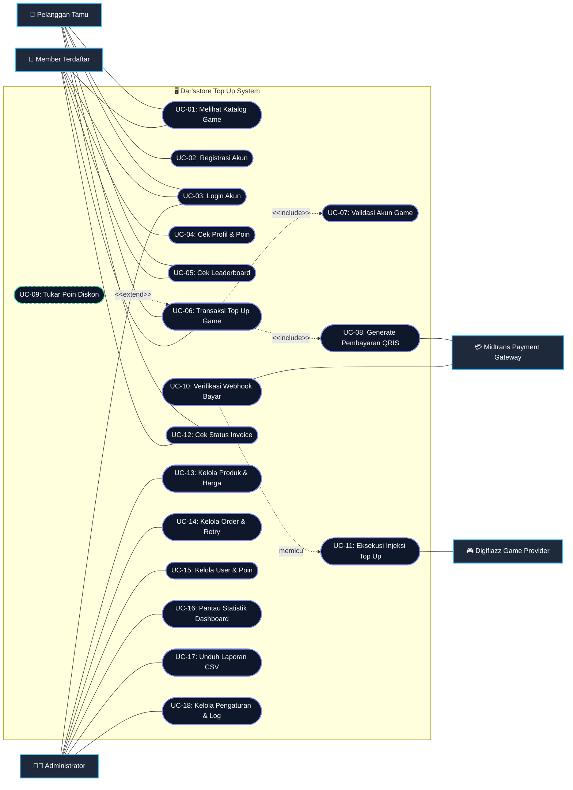
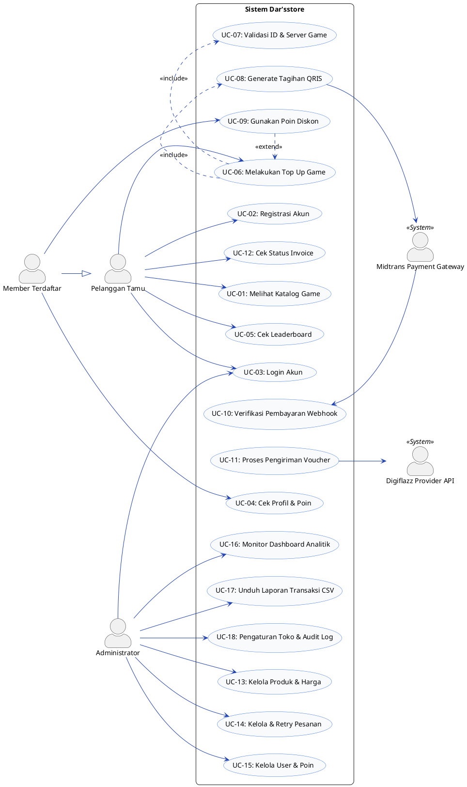

# 📘 Panduan & Dokumen Arahan: Perancangan Use Case Diagram
**Studi Kasus & Implementasi: Dar'sstore (Platform Top Up Games)**

---

## 1. Pendahuluan

Dokumen ini disusun sebagai panduan standar rekayasa perangkat lunak (*software engineering guideline*) untuk merancang, memvalidasi, dan mendokumentasikan **Use Case Diagram** serta **Use Case Specification (Skenario Naratif)**.

Dokumen ini menggunakan sistem nyata **Dar'sstore** (platform top-up game berbasis web untuk Mobile Legends & Valorant dengan integrasi Midtrans QRIS, API Digiflazz, dan Admin Dashboard) sebagai acuan studi kasus implementasi.

### 1.1 Tujuan Pembuatan Use Case Diagram
1. **Memetakan Batasan Sistem (*System Boundary*)**: Menentukan fungsi mana yang berada di dalam lingkup sistem dan entitas apa saja yang berinteraksi dari luar.
2. **Mengidentifikasi Aktor (*Actors*)**: Mengelompokkan jenis pengguna dan sistem eksternal berdasarkan peran (*role*), bukan jabatan orang.
3. **Mendefinisikan Kebutuhan Fungsional (*Functional Requirements*)**: Menjelaskan **apa** (*what*) yang dapat dilakukan sistem bagi aktor untuk mencapai tujuan bernilai (*business goal*), tanpa masuk ke teknis implementasi (*how*).
4. **Jembatan Komunikasi**: Menjadi dasar acuan yang mudah dipahami oleh developer, UI/UX designer, tester/QA, dan stakeholder bisnis.

---

## 2. Kaidah Notasi Standar UML Use Case

Gunakan simbol-simbol standar UML (*Unified Modeling Language*) berikut:

| Simbol / Elemen | Representasi Visual | Definisi & Aturan Penggunaan |
| :--- | :--- | :--- |
| **System Boundary** | Kotak persegi panjang dengan label nama sistem di bagian atas | Membatasi ruang lingkup sistem. Use case berada **di dalam** kotak, sedangkan Aktor berada **di luar** kotak. |
| **Actor** | Simbol figur stik (*stick man*) atau kotak bertuliskan `<<system>>` | Entitas eksternal yang memicu atau menerima hasil interaksi sistem (pengguna manusia atau sistem pihak ketiga). |
| **Use Case** | Bentuk elips/oval mendatar | Unit fungsionalitas yang menghasilkan nilai terukur bagi aktor. Harus menggunakan kaidah penamaan **[Kata Kerja Aktif] + [Objek]** (contoh: *Melakukan Top Up*, bukan *Top Up Diamond*). |
| **Association** | Garis lurus pejal (*solid line*) tanpa panah | Menghubungkan aktor dengan use case yang berinteraksi dengannya. |
| **Include (`<<include>>`)** | Garis putus-putus berpanah terbuka dari Use Case Asal ke Use Case Tambahan | Hubungan **wajib** (*mandatory*). Use case asal tidak dapat selesai tanpa mengeksekusi use case yang di-include. |
| **Extend (`<<extend>>`)** | Garis putus-putus berpanah terbuka dari Use Case Tambahan/Ekstensi ke Use Case Dasar | Hubungan **opsional/kondisional**. Use case dasar tetap bisa berjalan tanpa use case ekstensi. Dieksekusi hanya jika *Extension Point* terpenuhi. |
| **Generalization** | Garis pejal berpanah segitiga tertutup mengarah ke super-elemen | Hubungan pewarisan (*inheritance*) antar aktor atau use case umum ke spesifik (contoh: *Admin* mewarisi kemampuan *User*). |

---

## 3. Identifikasi Aktor & Ruang Lingkup (Dar'sstore)

### 3.1 Profil Aktor
Sistem Dar'sstore memiliki 4 kategori aktor:

1. **Pengguna Publik / Tamu (*Guest Customer*)** *(Primary Actor)*:
   - Pelanggan yang mengunjungi situs untuk bertransaksi tanpa perlu mendaftar/masuk akun.
   - Mengisi identitas game, memilih nominal, membayar QRIS, dan menerima pesanan.
2. **Member / Pengguna Terdaftar (*Registered Member*)** *(Primary Actor)*:
   - Pelanggan yang memiliki akun terotentikasi.
   - Mewarisi seluruh kapabilitas Tamu, ditambah hak istimewa: mengumpulkan poin loyalitas, melihat riwayat transaksi, dan masuk peringkat *Leaderboard*.
3. **Administrator Toko (*Store Admin*)** *(Primary Actor / Secondary)*:
   - Mengelola katalog produk, mengawasi status pesanan, mengatur saldo provider, memproses *refund/retry*, serta mengunduh laporan keuangan.
4. **Sistem Eksternal (*External Supporting Actors*)**:
   - **Payment Gateway (Midtrans Core API)**: Memvalidasi transaksi QRIS dan mengirimkan sinyal notifikasi melalui *webhook*.
   - **Provider Game Voucher (Digiflazz API)**: Memproses injeksi *diamond/points* ke akun game pelanggan secara otomatis.

---

## 4. Matriks & Daftar Use Case Sistem Dar'sstore

| ID UC | Nama Use Case | Aktor Terkait | Keterangan Relasi |
| :--- | :--- | :--- | :--- |
| **UC-01** | Mengakses Katalog & Game | Tamu, Member | Menampilkan daftar game (MLBB, Valorant) & FAQ |
| **UC-02** | Melakukan Pendaftaran Akun | Tamu | Membuat akun baru |
| **UC-03** | Masuk ke Sistem (Login) | Tamu, Member, Admin | Autentikasi kredensial (JWT) |
| **UC-04** | Mengelola Profil & Cek Poin | Member | Melihat saldo poin loyalitas |
| **UC-05** | Melihat Leaderboard | Tamu, Member | Peringkat top-spender pelanggan |
| **UC-06** | Melakukan Transaksi Top Up | Tamu, Member | Use Case Inti Toko |
| **UC-07** | Validasi ID Game | Sistem Internal | `<<include>>` dari UC-06 |
| **UC-08** | Membuat Tagihan QRIS | Midtrans API | `<<include>>` dari UC-06 |
| **UC-09** | Menggunakan Poin Potongan Harga | Member | `<<extend>>` ke UC-06 (Kondisi: jika poin > 0) |
| **UC-10** | Memproses Notifikasi Pembayaran (Webhook) | Midtrans API | Mengubah status order menjadi `paid` |
| **UC-11** | Memproses Antrean Top Up Otomatis | Digiflazz API | Otomatisasi pengiriman voucher setelah status `paid` |
| **UC-12** | Melacak Status Pesanan (Cek Invoice) | Tamu, Member | Tracking status via invoice number |
| **UC-13** | Mengelola Katalog Produk | Admin | Tambah, ubah harga, hapus, aktifkan produk |
| **UC-14** | Mengelola Pesanan & Transaksi | Admin | Lihat detail, retry pesanan gagal, tandai selesai |
| **UC-15** | Mengelola Data Pengguna & Poin | Admin | Penyesuaian poin manual, blokir/unblokir akun |
| **UC-16** | Melihat Statistik Dashboard | Admin | Total penjualan, omset, grafik performa |
| **UC-17** | Mengunduh Laporan Transaksi (CSV) | Admin | Ekspor laporan penjualan |
| **UC-18** | Mengelola Pengaturan Toko & Log Audit | Admin | Maintenance mode, webhook secrets, audit trail |

---

## 5. Visualisasi Use Case Diagram

### 5.1 Diagram Menggunakan Mermaid (Render Langsung)



---

### 5.2 Kode Sumber PlantUML (Untuk Draw.io / PlantText)

Bagi Anda yang menggunakan **Draw.io**, **Visual Paradigm**, atau **PlantText**, salin kode berikut:



---

## 6. Template Skenario Use Case (Use Case Specification)

Use Case Diagram harus selalu didampingi oleh **Use Case Specification** naratif. Gunakan format standar berikut:

### 6.1 Format Standar Dokumen Skenario

```markdown
Nama Use Case    : [Kata kerja aktif + Objek]
ID Use Case      : UC-XX
Aktor Utama      : [Aktor yang memulai inisiasi]
Aktor Pendukung  : [Aktor sistem/eksternal yang terlibat]
Deskripsi        : [Ringkasan 1-2 kalimat tujuan use case]
Pre-Condition    : [Syarat awal yang harus terpenuhi sebelum use case dimulai]
Post-Condition   : [Kondisi sistem setelah use case berhasil diselesaikan]
Extension Points : [Titik pemanggilan relasi extend jika ada]

Alur Utama (Main Flow):
1. Aktor melakukan aksi X.
2. Sistem memvalidasi Y.
3. Sistem menampilkan hasil Z.

Alur Alternatif (Alternative Flow):
- 2a. Jika data tidak valid:
  1. Sistem menampilkan pesan galat.
  2. Aktor kembali ke langkah 1.

Alur Pengecualian (Exception Flow):
- 3a. Jika koneksi ke server/API pihak ketiga terputus:
  1. Sistem mencatat log error.
  2. Sistem memberitahu pengguna untuk mencoba beberapa saat lagi.
```

---

### 6.2 Contoh Implementasi Nyata: UC-06 (Melakukan Transaksi Top Up)

```markdown
Nama Use Case    : Melakukan Transaksi Top Up Game
ID Use Case      : UC-06
Aktor Utama      : Pelanggan Tamu, Member Terdaftar
Aktor Pendukung  : Midtrans Payment Gateway, Digiflazz Provider
Deskripsi        : Pelanggan memilih paket game, memasukkan data akun game, 
                   memilih metode pembayaran QRIS, dan menerima instruksi bayar.
Pre-Condition    : Halaman form game (MLBB / Valorant) telah terbuka dan produk aktif tersedia.
Post-Condition   : Pesanan tersimpan di database dengan status 'pending' dan kode QRIS siap dipindai.
Extension Points : [Tukar Poin Diskon] saat pelanggan login memiliki poin loyalty.

Alur Utama:
1. Pelanggan memasukkan ID Akun Game (User ID + Zone ID untuk MLBB atau Riot ID untuk Valorant).
2. Sistem mengeksekusi validasi format data akun (UC-07).
3. Pelanggan memilih salah satu nominal / paket diamond.
4. Pelanggan memilih metode pembayaran QRIS (Midtrans).
5. Pelanggan memasukkan nomor kontak WhatsApp/Email konfirmasi.
6. Pelanggan menekan tombol "Beli Sekarang".
7. Sistem memverifikasi ketersediaan produk dan menghitung total harga tagihan.
8. Sistem menghubungi API Midtrans Core untuk menghasilkan data QRIS aktif (UC-08).
9. Sistem menyimpan pesanan baru dengan status 'pending' dan nomor Invoice unik.
10. Sistem mengalihkan pelanggan ke halaman Invoice/Pembayaran berisi gambar QRIS, batas waktu, dan detail pesanan.

Alur Alternatif:
- 1a. Pelanggan dalam kondisi terotentikasi (Member) dan memiliki saldo poin:
  1. Sistem menampilkan opsi checkbox "Gunakan Poin Diskon" (UC-09).
  2. Pelanggan mengaktifkan opsi tersebut.
  3. Total harga dikurangi sesuai nominal poin yang dikonversi.
  4. Alur berlanjut ke langkah 4.

Alur Pengecualian:
- 2a. Format ID Game tidak sesuai atau kosong:
  1. Sistem memunculkan alert validasi merah di bawah input form.
  2. Alur terhenti sampai pelanggan memperbaiki input.
- 8a. API Midtrans mengalami timeout atau kegagalan koneksi:
  1. Sistem mencatat log error gateway.
  2. Sistem menampilkan notifikasi: "Gagal membuat kode pembayaran, silakan ulangi sesaat lagi".
  3. Status order tidak disimpan.
```

---

### 6.3 Contoh Implementasi Nyata: UC-10 (Verifikasi Webhook Pembayaran)

```markdown
Nama Use Case    : Verifikasi Pembayaran Webhook
ID Use Case      : UC-10
Aktor Utama      : Midtrans Payment Gateway (Eksternal)
Aktor Pendukung  : Sistem Dar'sstore, Digiflazz Provider
Deskripsi        : Menerima callback HTTP POST dari Midtrans saat pelanggan telah sukses membayar QRIS,
                   memverifikasi signature key, dan memperbarui status order.
Pre-Condition    : Pesanan ada di database dengan status 'pending'.
Post-Condition   : Status order berubah menjadi 'paid' atau 'failed', dan antrean top up dipicu (UC-11).

Alur Utama:
1. Midtrans mengirimkan payload webhook JSON ke endpoint `/api/webhook/payment`.
2. Sistem menghitung SHA512 signature key berdasarkan `order_id`, `status_code`, `gross_amount`, dan Server Key.
3. Sistem mencocokkan signature yang dihitung dengan `signature_key` dari Midtrans.
4. Jika cocok dan status transaksi adalah `settlement` atau `capture`:
   a. Sistem memperbarui status order menjadi `paid`.
   b. Sistem menambahkan riwayat payment log.
   c. Sistem memicu job otomatisasi injeksi voucher ke API Digiflazz (UC-11).
   d. Jika pemesan adalah Member, sistem menambahkan poin loyalitas ke akun pengguna.
5. Sistem mengembalikan response HTTP 200 OK ke Midtrans.

Alur Alternatif / Pengecualian:
- 3a. Signature Key tidak valid (indikasi manipulasi request):
  1. Sistem menolak payload dan mengembalikan HTTP 403 Forbidden.
  2. Transaksi tidak diubah.
- 4a. Transaksi kedaluwarsa (expire) atau dibatalkan (cancel):
  1. Sistem memperbarui status order menjadi `failed`.
  2. Job top up tidak dipicu.
```

---

## 7. Aturan Penting: Perbedaan `<<include>>` vs `<<extend>>`

Banyak perancang diagram keliru membedakan kedua relasi ini. Perhatikan aturan paten berikut:

```
+-----------------------------------------------------------------------------------+
| <<include>> (KEHARUSAN)                                                           |
+-----------------------------------------------------------------------------------+
| • Sifat    : Wajib (Mandatory)                                                    |
| • Arah     : Dari Use Case Dasar  ───>>  Use Case Tambahan                        |
| • Makna    : Use Case dasar TIDAK LENGKAP tanpa Use Case tambahan.                |
| • Contoh   : "Melakukan Top Up" --<<include>>--> "Generate QRIS"                 |
|             (Transaksi top up sistem ini tidak bisa berhasil tanpa membuat QRIS)  |
+-----------------------------------------------------------------------------------+

+-----------------------------------------------------------------------------------+
| <<extend>> (OPSIONAL / KONDISIONAL)                                               |
+-----------------------------------------------------------------------------------+
| • Sifat    : Opsional / Kondisional                                               |
| • Arah     : Dari Use Case Ekstensi  ───>>  Use Case Dasar                       |
| • Makna    : Use Case dasar TETAP LENGKAP dan BISA SELESAI tanpa ekstensi.        |
| • Contoh   : "Tukar Poin Diskon" --<<extend>>--> "Melakukan Top Up"              |
|             (Pelanggan tetap bisa top up tanpa harus menukar poin)                |
+-----------------------------------------------------------------------------------+
```

---

## 8. Anti-Patterns (Kesalahan Umum yang Harus Dihindari)

1. **Flowchart Trap (Mentalitas Bagan Alur)**
   - *Salah*: Menggambar use case bertahap seperti: `[Buka Halaman]` -> `[Pilih Game]` -> `[Input ID]` -> `[Klik Bayar]`.
   - *Benar*: Seluruh tahapan tersebut merupakan langkah-langkah di dalam **satu Use Case** bernilai utuh: `[Melakukan Transaksi Top Up]`.
2. **Aktor di Dalam Kotak Sistem**
   - Aktor manusia atau API luar **tidak boleh** digambar di dalam kotak *System Boundary*.
3. **Kata Benda Sebagai Nama Use Case**
   - *Salah*: `[Pembayaran QRIS]`, `[Katalog]`, `[User]`.
   - *Benar*: Gunakan format kata kerja aktif: `[Melakukan Pembayaran QRIS]`, `[Melihat Katalog Game]`, `[Mengelola Pengguna]`.
4. **Relasi Aktor ke Aktor Secara Langsung**
   - Aktor tidak boleh dihubungkan langsung dengan garis asosiasi ke aktor lain (kecuali relasi pewarisan / *Generalization*).
5. **Menghubungkan Dua Use Case Menggunakan Garis Lurus Tanpa Keterangan**
   - Antara use case dan use case hanya boleh dihubungkan dengan relasi bertipe `<<include>>`, `<<extend>>`, atau *Generalization*. Tidak boleh memakai garis asosiasi pejal biasa.

---

## 9. Checklist Verifikasi & Validasi (Quality Assurance)

Sebelum memfinalisasi atau mempresentasikan Use Case Diagram, periksa hal-hal berikut:

- [ ] **System Boundary**: Apakah kotak sistem sudah diberi label nama yang jelas (*Dar'sstore Top Up System*)?
- [ ] **Penamaan Aktor**: Apakah aktor menggunakan kata benda peranan (*Guest Customer*, *Store Admin*, *Payment Gateway*) dan bukan nama orang?
- [ ] **Penamaan Use Case**: Apakah seluruh use case diawali kata kerja transitif + objek?
- [ ] **Arah Panah Include**: Apakah panah putus-putus `<<include>>` mengarah dari use case utama ke use case pendukung?
- [ ] **Arah Panah Extend**: Apakah panah putus-putus `<<extend>>` mengarah dari use case tambahan kembali ke use case dasar?
- [ ] **Kelayakan Bisnis**: Apakah setiap use case memberikan hasil yang bernilai bagi aktor terkait?
- [ ] **Skenario Naratif**: Apakah use case inti (khususnya alur transaksi dan webhook) sudah memiliki dokumen skenario *Main Flow* dan *Exception Flow*?
- [ ] **Sistem Eksternal**: Apakah pihak ketiga yang memicu komunikasi API (Midtrans & Digiflazz) digambarkan sebagai aktor eksternal?

---

## 10. Rekomendasi Perangkat Lunak (*Tools*) untuk Menggambar

1. **Draw.io (diagrams.net)**:
   - Gratis, mendukung web dan desktop.
   - Tersedia shape pack UML Use Case lengkap.
   - Mendukung impor PlantUML via menu *Arrange > Insert > Advanced > PlantUML*.
2. **Visual Paradigm**:
   - Standar industri untuk rekayasa perangkat lunak dan tugas akademik/skripsi.
   - Memiliki fitur pembuatan Use Case Specification dan integrasi Class Diagram.
3. **PlantText / PlantUML (Visual Studio Code Extension)**:
   - Menghasilkan diagram berbasis teks (*Diagram as Code*) yang ramah version control (Git).
4. **Lucidchart**:
   - Sangat baik untuk kolaborasi tim secara *real-time*.
